# LAPORAN PRAKTIKUM 9

## PHP MODULAR

### Identitas Mahasiswa

| | |
|---|---|
| **Nama** | *Rafa Muhammad Fauzan* |
| **NIM** | *312510277* |
| **Kelas** | *I251C* |
| **Program Studi** | *Teknik Informatika* |
| **Mata Kuliah** | Pemrograman Web |
| **Tugas** | Praktikum 9 — PHP Modular |
| **Link Repository** | *https://github.com/RafaMuhammadFauzan13/Lab9Web.git* |

---

## Pengertian Praktikum

Praktikum 9 membahas modularisasi program PHP, yaitu teknik membagi aplikasi menjadi file-file kecil yang memiliki tanggung jawab jelas. Pada praktikum ini dipelajari pemanggilan file dengan `include`, `require`, `include_once`, dan `require_once`, pembuatan template (header dan footer) yang dipakai bersama oleh banyak halaman, pembuatan *function* beserta file *helper*, penataan struktur direktori aplikasi, dan *routing* sederhana berbasis parameter URL dengan *whitelist* serta halaman 404. Semua teknik tersebut kemudian diterapkan pada aplikasi CRUD data barang dari Praktikum 8, dilanjutkan dengan tantangan mandiri berupa menu aktif, pesan sukses/gagal, pembatasan akses login, dan URL rewrite memakai `.htaccess`.

## Tujuan Praktikum

1. Menjelaskan pengertian, tujuan, dan manfaat modularisasi program.
2. Membedakan penggunaan `include`, `require`, `include_once`, dan `require_once`.
3. Membuat template halaman web yang digunakan bersama oleh beberapa halaman.
4. Membuat dan menggunakan function PHP dengan parameter dan nilai kembalian.
5. Menyusun struktur direktori aplikasi PHP secara modular.
6. Menerapkan routing berdasarkan parameter URL dengan validasi halaman.
7. Mengintegrasikan modularisasi dan routing ke aplikasi database dari praktikum sebelumnya.

## Perangkat

Laptop/PC, web browser, Visual Studio Code, PHP, dan server lokal XAMPP (Apache dan MySQL).

## Cara Menjalankan Server Lokal

1. Buka XAMPP Control Panel lalu klik **Start** pada modul **Apache** dan **MySQL**.
2. Pastikan database `latihan1` dengan tabel `data_barang` dari Praktikum 8 sudah ada di phpMyAdmin (`http://localhost/phpmyadmin/`). Latihan 4 dan Tantangan memakai database yang sama.
3. Salin folder `Lab9Web` ke `htdocs` (contoh: `C:\xampp\htdocs\Lab9Web`).
4. Buka browser dan akses alamat berikut.

| Bagian | Alamat |
|---|---|
| Praktik include/require dan template | `http://localhost/Lab9Web/lab9_php_modular/uji-include.php` |
| Latihan 1 | `http://localhost/Lab9Web/Latihan1/home.php` |
| Latihan 2 | `http://localhost/Lab9Web/latihan2/produk.php` |
| Latihan 3 | `http://localhost/Lab9Web/Latihan3/index.php` |
| Latihan 4 | `http://localhost/Lab9Web/Latihan4/index.php` |
| Tantangan | `http://localhost/Lab9Web/Tantangan/index.php` |

5. Khusus **Tantangan**, halaman barang hanya bisa dibuka setelah login. Tabel `users` dan akun uji dibuat sekali dengan skrip pada langkah 11. Akun uji (hanya untuk pengujian lokal): username `admin`, password `admin123`.
6. Fitur URL ringkas (`/barang/list`) membutuhkan `mod_rewrite` aktif dan `AllowOverride All` pada Apache (lihat langkah 12).

File PHP tidak boleh dibuka dengan klik ganda (`file://`) karena tidak diproses oleh PHP.

## Struktur File

```text
Lab9Web/
├── lab9_php_modular/        (praktik include/require, template, function)
│   ├── pesan.php
│   ├── uji-include.php
│   ├── uji-require.php
│   ├── header.php
│   ├── footer.php
│   ├── home.php
│   ├── about.php
│   ├── kontak.php
│   ├── style.css
│   ├── helpers.php
│   ├── contoh-function.php
│   ├── contoh-panggil.php
│   ├── latihan-suhu-nilai.php
│   └── latihan-belanja.php
├── Latihan1/                (template multi-halaman)
│   ├── header.php
│   ├── footer.php
│   ├── home.php
│   ├── profil.php
│   ├── kontak.php
│   └── style.css
├── latihan2/                (library function)
│   ├── helpers/functions.php
│   ├── header.php
│   ├── footer.php
│   ├── produk.php
│   ├── daftar.php
│   └── style.css
├── Latihan3/                (router aman, 5 rute + 404)
│   ├── index.php
│   ├── helpers/functions.php
│   ├── views/ (header, footer, 404, home, tentang, profil, produk, kontak)
│   └── style.css
├── Latihan4/                (refactoring CRUD)
│   ├── index.php            (router)
│   ├── config/database.php
│   ├── helpers/functions.php
│   ├── views/ (header, footer, 404)
│   ├── modules/barang/ (list, add, edit, delete)
│   ├── assets/css/style.css
│   └── gambar/
├── Tantangan/               (salinan Latihan4 + 4 tantangan mandiri)
│   ├── .htaccess
│   ├── index.php
│   ├── config/database.php
│   ├── helpers/functions.php
│   ├── views/ (header, footer, 404)
│   ├── modules/barang/ (list, add, edit, delete)
│   ├── modules/auth/ (login, logout)
│   ├── assets/css/style.css
│   └── gambar/
├── project/                 (kerangka router awal dari modul)
├── images/                  (screenshot untuk README)
└── README.md
```

---

## Langkah-Langkah Pengerjaan

### 1. Persiapan — Menjalankan Apache dan MySQL

**Tujuan:** Memastikan server lokal berjalan sebelum menguji program.

**Pembahasan:** Apache berfungsi sebagai web server yang memproses PHP, sedangkan MySQL dibutuhkan oleh Latihan 4 dan Tantangan. Keduanya dijalankan lewat XAMPP Control Panel dengan tombol **Start**. Folder `Lab9Web` diletakkan di `htdocs` agar dapat diakses lewat `http://localhost/Lab9Web/`.

**Hasil Browser:**

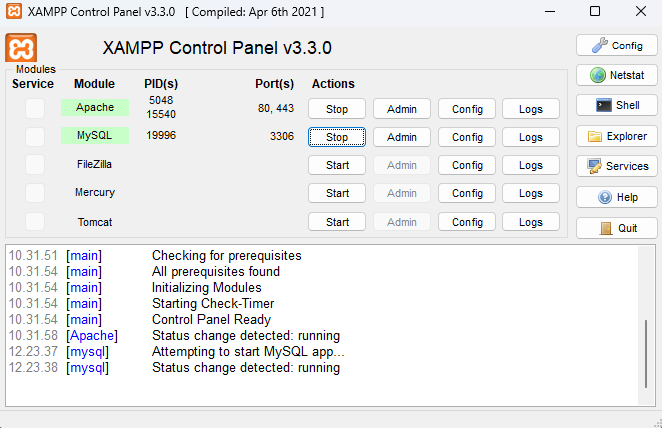

**Keterangan:**

Apache dan MySQL berstatus *running* (ditandai warna hijau).

---

### 2. Menguji `include` dan `require`

**Tujuan:** Mengetahui perbedaan `include` dan `require` ketika file yang dipanggil tidak ditemukan.

**Pembahasan:** Dibuat folder `lab9_php_modular` berisi `pesan.php`, `uji-include.php`, dan `uji-require.php`. Pengujian dilakukan dua kali: saat `pesan.php` ada, lalu saat namanya diubah sementara menjadi `pesan2.php`. `__DIR__` dipakai agar path file selalu benar walaupun file dipanggil dari lokasi berbeda.

**CODING (`pesan.php`):**

```php
<?php
echo "Ini isi pesan.php<br>";
?>
```

**CODING (`uji-include.php`):**

```php
<?php
echo "Sebelum pemanggilan<br>";
include __DIR__ . '/pesan.php';
echo "Sesudah pemanggilan<br>";
?>
```

**CODING (`uji-require.php`):**

```php
<?php
echo "Sebelum pemanggilan<br>";
require __DIR__ . '/pesan.php';
echo "Sesudah pemanggilan<br>";
?>
```

**Hasil Browser:**

Kondisi normal (`pesan.php` ada):

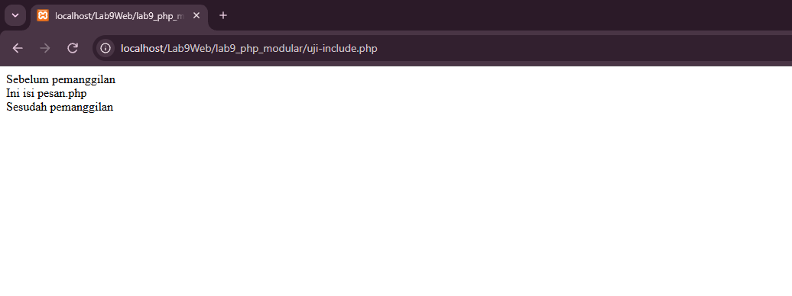

`include` saat file tidak ditemukan:

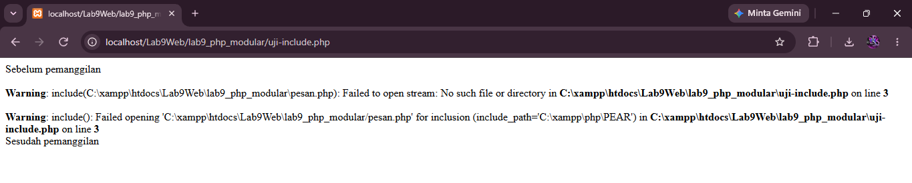

`require` saat file tidak ditemukan:

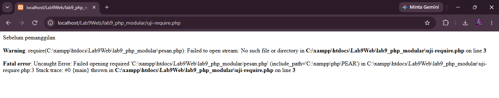

`require` setelah nama file dikembalikan:

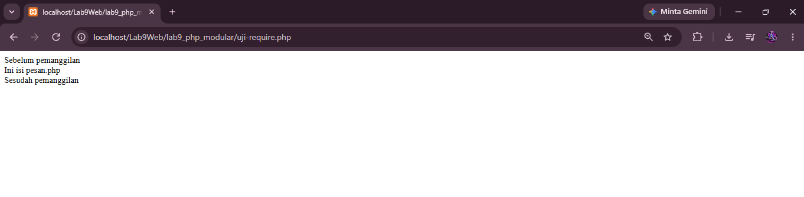

**Keterangan:**

| | `include` | `require` |
|---|---|---|
| File tidak ditemukan | *Warning* | *Fatal error* |
| Baris setelah pemanggilan | Tetap dijalankan | Tidak dijalankan (program berhenti) |
| Cocok untuk | File tambahan yang tidak kritis | File wajib, misalnya konfigurasi database |

Pada pengujian `include`, baris "Sesudah pemanggilan" tetap tampil walaupun muncul dua pesan *Warning*. Pada `require`, muncul *Warning* lalu *Fatal error* dan baris "Sesudah pemanggilan" tidak tampil. Setelah pengujian, nama file `pesan.php` dikembalikan.

---

### 3. Membuat Template Layout

**Tujuan:** Membuat header, navigasi, dan footer yang dipakai bersama oleh beberapa halaman.

**Pembahasan:** `header.php` berisi awal dokumen HTML, judul, dan navigasi, sedangkan `footer.php` berisi penutup halaman. Setiap halaman hanya memuat konten khususnya, lalu memanggil header dan footer dengan `require_once`. File `kontak.php` mengikuti pola yang sama dengan `home.php` dan `about.php`.

**CODING (`header.php`):**

```php
<!DOCTYPE html>
<html lang="id">
<head>
 <meta charset="UTF-8">
 <meta name="viewport" content="width=device-width, initial-scale=1">
 <title>Aplikasi PHP Modular</title>
 <link rel="stylesheet" href="style.css">
</head>
<body>
<div class="container">
 <header>
 <h1>Aplikasi PHP Modular</h1>
 <p>Contoh pemisahan template dan konten</p>
 </header>
 <nav>
 <a href="home.php">Home</a>
 <a href="about.php">Tentang</a>
 <a href="kontak.php">Kontak</a>
 </nav>
 <main>
```

**CODING (`footer.php`):**

```php
 </main>
 <footer>
 <p>&copy; <?php echo date('Y'); ?> - Praktikum Pemrograman Web</p>
 </footer>
</div>
</body>
</html>
```

**CODING (`home.php`):**

```php
<?php require_once __DIR__ . '/header.php'; ?>
<section class="content">
 <h2>Halaman Home</h2>
 <p>Ini adalah konten khusus halaman beranda.</p>
</section>
<?php require_once __DIR__ . '/footer.php'; ?>
```

**CODING (`about.php`):**

```php
<?php require_once __DIR__ . '/header.php'; ?>
<section class="content">
 <h2>Tentang Aplikasi</h2>
 <p>Halaman ini menjelaskan tujuan aplikasi.</p>
</section>
<?php require_once __DIR__ . '/footer.php'; ?>
```

**CODING (`kontak.php`):**

```php
<?php require_once __DIR__ . '/header.php'; ?>
<section class="content">
 <h2>Kontak</h2>
 <p>Isi konten halaman kontak di sini.</p>
</section>
<?php require_once __DIR__ . '/footer.php'; ?>
```

**CODING (`style.css`):**

```css
* { box-sizing: border-box; }
body {
 margin: 0;
 font-family: Arial, sans-serif;
 background: #f4f6f8;
 color: #263238;
}
.container {
 max-width: 960px;
 margin: 30px auto;
 background: #fff;
 padding: 24px;
}
header, footer { padding: 16px; background: #eaf2f8; }
nav { display: flex; gap: 16px; padding: 14px 0; }
nav a { color: #145a86; text-decoration: none; }
nav a:hover { text-decoration: underline; }
main { min-height: 220px; padding: 16px 0; }
footer { text-align: center; font-size: 14px; }
```

**Hasil Browser:**

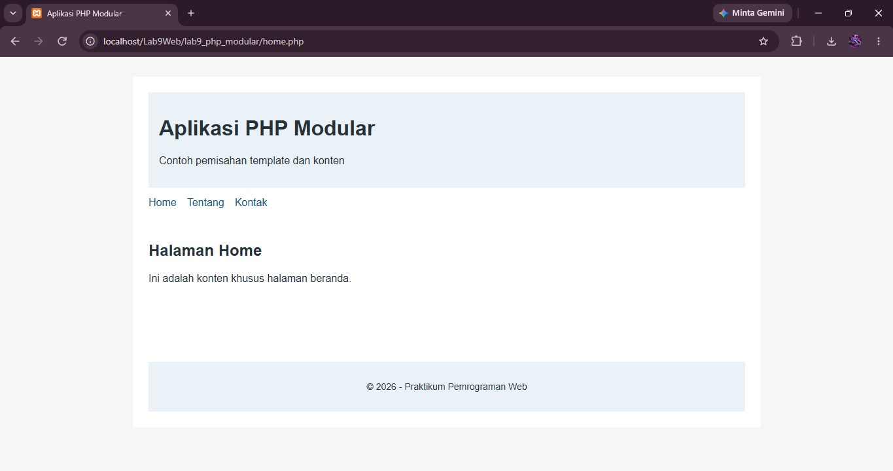

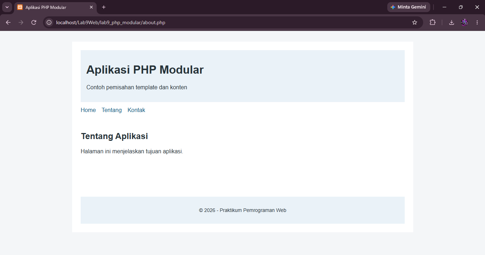

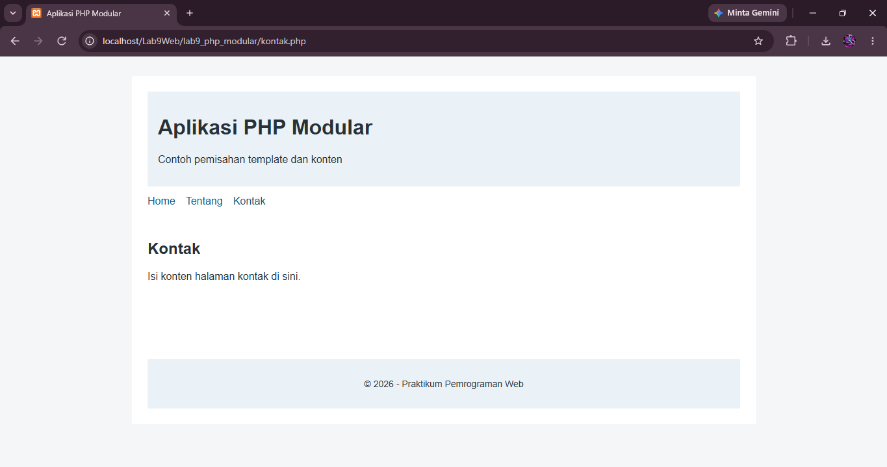

Setelah teks navigasi "Home" pada `header.php` diubah menjadi "Beranda":


**Keterangan (analisis hasil):**

1. **Bagian yang digunakan bersama:** `header.php` (awal dokumen HTML, judul, banner, dan navigasi), `footer.php` (penutup halaman dan hak cipta), serta `style.css`.
2. **Jika teks navigasi diubah pada `header.php`:** semua halaman yang memanggil `header.php` ikut berubah tanpa mengedit satu per satu. Terbukti pada tangkapan layar, "Home" menjadi "Beranda". Teks kemudian dikembalikan ke "Home".
3. **Mengapa konten tidak diletakkan seluruhnya di `header.php`:** `header.php` dipakai semua halaman sehingga isinya harus bagian yang sama saja. Jika konten khusus ditaruh di sana, semua halaman akan menampilkan isi yang sama.
4. **Manfaat `require_once` dibanding menyalin kode header:** kode tidak berulang, perubahan cukup di satu file, pemeliharaan lebih mudah, file tidak termuat dua kali, dan program berhenti jika file template hilang sehingga masalah cepat diketahui.

---

### 4. Function pada PHP

**Tujuan:** Membuat function dengan parameter dan nilai kembalian, lalu memindahkannya ke file *helper*.

**Pembahasan:** Contoh function dari modul dikumpulkan di `contoh-function.php`. Untuk latihan function dibuat tiga function baru, yaitu `konversiCelciusKeFahrenheit()`, `tentukanStatusNilai()`, dan `hitungTotal()`. Seluruh function dipindahkan ke `helpers.php` bersama `formatRupiah()` dan `e()`, lalu dipanggil dari dua halaman berbeda (`latihan-suhu-nilai.php` dan `latihan-belanja.php`).

**CODING (`contoh-function.php`):**

```php
<?php
// 1. Function tanpa parameter
function tampilkanSalam() {
 echo "Selamat belajar PHP modular!";
}
tampilkanSalam();

echo "<br>";

// 2. Function dengan parameter
function sapaPengguna($nama) {
 echo "Halo, " . htmlspecialchars($nama, ENT_QUOTES, 'UTF-8');
}
sapaPengguna("Rina");

echo "<br>";

// 3. Function dengan return
function hitungLuasPersegiPanjang($panjang, $lebar) {
 return $panjang * $lebar;
}
$luas = hitungLuasPersegiPanjang(8, 5);
echo "Luas: " . $luas;

echo "<br>";

// 4. Type declaration dan nilai default
function hitungDiskon(float $harga, float $persen = 10): float {
 return $harga * ($persen / 100);
}
echo hitungDiskon(200000); // diskon 10%
echo "<br>";
echo hitungDiskon(200000, 15); // diskon 15%
?>
```

**CODING (`helpers.php`):**

```php
<?php
function formatRupiah(float $angka): string {
 return 'Rp ' . number_format($angka, 0, ',', '.');
}

function e(string $nilai): string {
 return htmlspecialchars($nilai, ENT_QUOTES, 'UTF-8');
}

// Latihan function 1
function konversiCelciusKeFahrenheit(float $c): float {
 return ($c * 9 / 5) + 32;
}

// Latihan function 2
function tentukanStatusNilai(float $nilai): string {
 if ($nilai >= 85) {
 return 'A';
 } elseif ($nilai >= 70) {
 return 'B';
 } elseif ($nilai >= 55) {
 return 'C';
 } elseif ($nilai >= 40) {
 return 'D';
 }
 return 'E';
}

// Latihan function 3
function hitungTotal(float $harga, int $jumlah): float {
 return $harga * $jumlah;
}
?>
```

**CODING (`latihan-suhu-nilai.php`):**

```php
<?php
require_once __DIR__ . '/helpers.php';
require_once __DIR__ . '/header.php';

$daftarSuhu = [0, 25, 37, 100];
$daftarNilai = [92, 78, 60, 45, 20];
?>
<section class="content">
 <h2>Konversi Celcius ke Fahrenheit</h2>
 <ul>
 <?php foreach ($daftarSuhu as $c): ?>
 <li><?php echo $c; ?> &deg;C = <?php echo konversiCelciusKeFahrenheit($c); ?> &deg;F</li>
 <?php endforeach; ?>
 </ul>

 <h2>Status Nilai</h2>
 <ul>
 <?php foreach ($daftarNilai as $n): ?>
 <li>Nilai <?php echo $n; ?> = <?php echo tentukanStatusNilai($n); ?></li>
 <?php endforeach; ?>
 </ul>
</section>
<?php require_once __DIR__ . '/footer.php'; ?>
```

**CODING (`latihan-belanja.php`):**

```php
<?php
require_once __DIR__ . '/helpers.php';
require_once __DIR__ . '/header.php';

$barang = [
 ['nama' => 'Buku Tulis', 'harga' => 5000, 'jumlah' => 10],
 ['nama' => 'Pulpen', 'harga' => 3500, 'jumlah' => 5],
 ['nama' => 'Penggaris', 'harga' => 4000, 'jumlah' => 2],
];
$totalSemua = 0;
?>
<section class="content">
 <h2>Total Belanja</h2>
 <table border="1" cellpadding="8" cellspacing="0">
 <tr>
 <th>Barang</th><th>Harga</th><th>Jumlah</th><th>Total</th>
 </tr>
 <?php foreach ($barang as $b): ?>
 <?php
 $total = hitungTotal($b['harga'], $b['jumlah']);
 $totalSemua += $total;
 ?>
 <tr>
 <td><?php echo e($b['nama']); ?></td>
 <td><?php echo formatRupiah($b['harga']); ?></td>
 <td><?php echo $b['jumlah']; ?></td>
 <td><?php echo formatRupiah($total); ?></td>
 </tr>
 <?php endforeach; ?>
 <tr>
 <td colspan="3"><strong>Total Keseluruhan</strong></td>
 <td><strong><?php echo formatRupiah($totalSemua); ?></strong></td>
 </tr>
 </table>
</section>
<?php require_once __DIR__ . '/footer.php'; ?>
```

**Hasil Browser:**

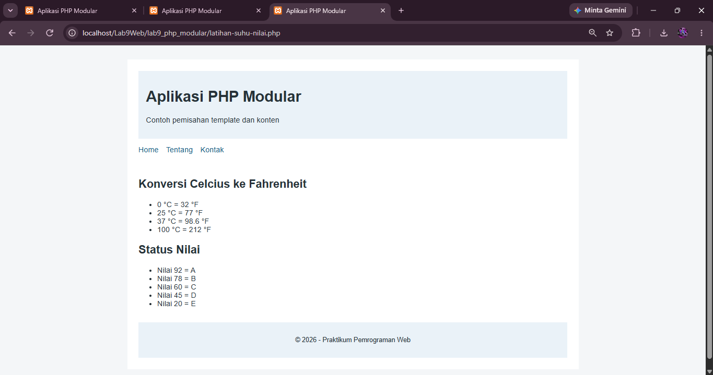

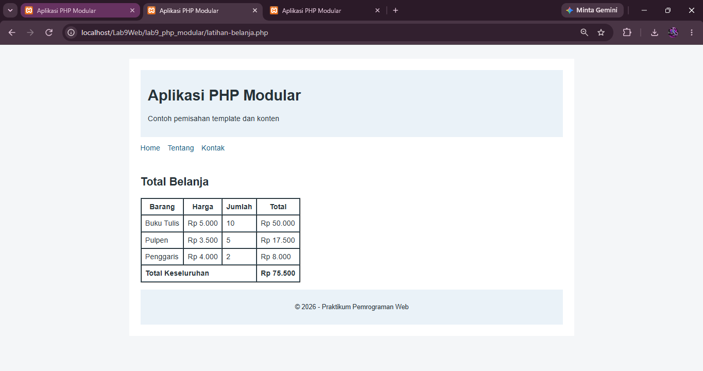

**Keterangan:**

Konversi suhu menghasilkan 0 °C = 32 °F, 25 °C = 77 °F, 37 °C = 98,6 °F, dan 100 °C = 212 °F. Status nilai 92 = A, 78 = B, 60 = C, 45 = D, dan 20 = E. Total belanja bernilai Rp 50.000, Rp 17.500, dan Rp 8.000 dengan total keseluruhan Rp 75.500. Karena `helpers.php` dimuat dengan `require_once`, function tidak dideklarasikan ganda.

---

### 5. Latihan 1 — Template Multi-Halaman

**Tujuan:** Membuat aplikasi dengan halaman Home, Profil, dan Kontak yang memakai header dan footer yang sama.

**Pembahasan:** Dibuat folder `Latihan1`. Pada `header.php` ditambahkan variabel `$judulHalaman` yang diisi oleh masing-masing halaman sehingga judul tab browser mengikuti halaman yang dibuka. Tidak ada salinan kode header/footer di file halaman, hanya `require_once`. Data pada halaman Kontak adalah data contoh.

**CODING (`header.php`):**

```php
<?php
$judulHalaman = $judulHalaman ?? 'Latihan 1';
?>
<!DOCTYPE html>
<html lang="id">
<head>
 <meta charset="UTF-8">
 <meta name="viewport" content="width=device-width, initial-scale=1">
 <title><?php echo htmlspecialchars($judulHalaman, ENT_QUOTES, 'UTF-8'); ?> - Aplikasi PHP Modular</title>
 <link rel="stylesheet" href="style.css">
</head>
<body>
<div class="container">
 <header>
 <h1>Aplikasi PHP Modular</h1>
 <p>Latihan 1 - Template multi-halaman</p>
 </header>
 <nav>
 <a href="home.php">Home</a>
 <a href="profil.php">Profil</a>
 <a href="kontak.php">Kontak</a>
 </nav>
 <main>
```

**CODING (`footer.php`):**

```php
 </main>
 <footer>
 <p>&copy; <?php echo date('Y'); ?> - Praktikum Pemrograman Web</p>
 </footer>
</div>
</body>
</html>
```

**CODING (`home.php`):**

```php
<?php
$judulHalaman = 'Home';
require_once __DIR__ . '/header.php';
?>
<section class="content">
 <h2>Halaman Home</h2>
 <p>Selamat datang di aplikasi PHP modular. Semua halaman memakai header dan footer yang sama.</p>
</section>
<?php require_once __DIR__ . '/footer.php'; ?>
```

**CODING (`profil.php`):**

```php
<?php
$judulHalaman = 'Profil';
require_once __DIR__ . '/header.php';
?>
<section class="content">
 <h2>Profil</h2>
 <table cellpadding="6">
 <tr><td>Nama</td><td>: Rafa Muhammad Fauzan</td></tr>
 <tr><td>NIM</td><td>: 312510277</td></tr>
 <tr><td>Kelas</td><td>: I251C</td></tr>
 <tr><td>Program Studi</td><td>: Teknik Informatika</td></tr>
 </table>
</section>
<?php require_once __DIR__ . '/footer.php'; ?>
```

**CODING (`kontak.php`):**

```php
<?php
$judulHalaman = 'Kontak';
require_once __DIR__ . '/header.php';
?>
<section class="content">
 <h2>Kontak</h2>
 <p>Hubungi kami melalui informasi berikut:</p>
 <ul>
 <li>Email: nama@email.com</li>
 <li>Telepon: 0812-0000-0000</li>
 <li>Alamat: Bekasi</li>
 </ul>
</section>
<?php require_once __DIR__ . '/footer.php'; ?>
```

**Hasil Browser:**

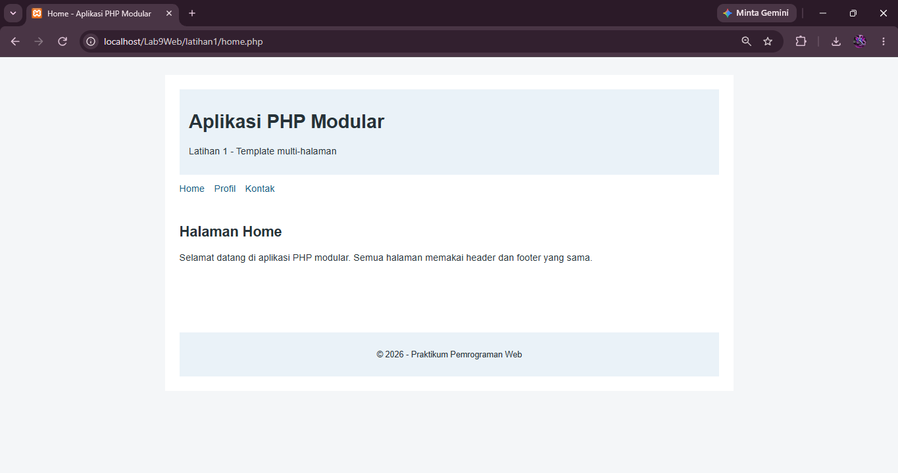

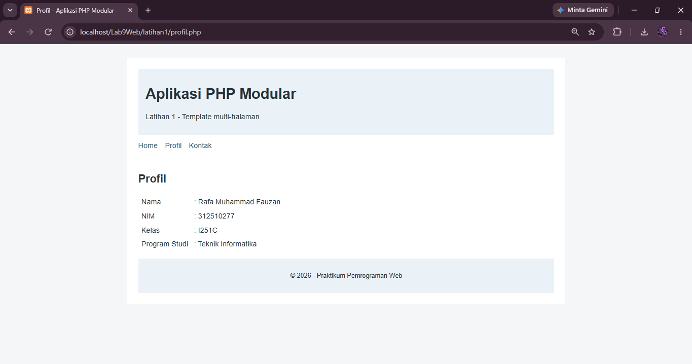

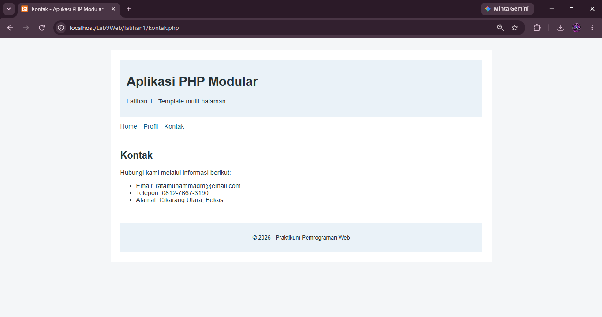

**Keterangan:**

Ketiga halaman menampilkan header, navigasi, dan footer yang sama dengan konten berbeda. Navigasi berfungsi dan judul tab berubah menjadi "Home", "Profil", dan "Kontak" sesuai halaman. Kriteria latihan terpenuhi: tidak ada salinan kode header/footer, navigasi berfungsi, dan tampilan konsisten.

---

### 6. Latihan 2 — Library Function

**Tujuan:** Membuat file `helpers/functions.php` berisi minimal empat function dan memakainya pada minimal dua halaman.

**Pembahasan:** Dibuat folder `latihan2` dengan `helpers/functions.php` yang berisi `formatRupiah()`, `hitungDiskon()`, `validasiEmail()`, `ringkasTeks()`, serta `e()` untuk *escaping* output. Function dipakai pada halaman `produk.php` (harga, diskon, dan ringkasan deskripsi) dan `daftar.php` (biaya, validasi email, dan ringkasan pesan).

**CODING (`helpers/functions.php`):**

```php
<?php
// Mengubah angka menjadi format rupiah, contoh: 150000 -> Rp 150.000
function formatRupiah(float $angka): string {
 return 'Rp ' . number_format($angka, 0, ',', '.');
}

// Menghitung NOMINAL diskon dari harga dan persen
function hitungDiskon(float $harga, float $persen = 10): float {
 return $harga * ($persen / 100);
}

// Mengecek apakah format email valid (true/false)
function validasiEmail(string $email): bool {
 return filter_var($email, FILTER_VALIDATE_EMAIL) !== false;
}

// Memotong teks panjang dan menambahkan "..." di akhir
function ringkasTeks(string $teks, int $batas = 100): string {
 if (mb_strlen($teks) <= $batas) {
 return $teks;
 }
 return mb_substr($teks, 0, $batas) . '...';
}

// Escape output agar aman ditampilkan di HTML
function e(string $nilai): string {
 return htmlspecialchars($nilai, ENT_QUOTES, 'UTF-8');
}
?>
```

**CODING (`header.php`):**

```php
<?php
$judulHalaman = $judulHalaman ?? 'Latihan 2';
?>
<!DOCTYPE html>
<html lang="id">
<head>
 <meta charset="UTF-8">
 <meta name="viewport" content="width=device-width, initial-scale=1">
 <title><?php echo htmlspecialchars($judulHalaman, ENT_QUOTES, 'UTF-8'); ?> - Aplikasi PHP Modular</title>
 <link rel="stylesheet" href="style.css">
</head>
<body>
<div class="container">
 <header>
 <h1>Aplikasi PHP Modular</h1>
 <p>Latihan 2 - Library function</p>
 </header>
 <nav>
 <a href="produk.php">Produk</a>
 <a href="daftar.php">Daftar</a>
 </nav>
 <main>
```

**CODING (`footer.php`):**

```php
 </main>
 <footer>
 <p>&copy; <?php echo date('Y'); ?> - Praktikum Pemrograman Web</p>
 </footer>
</div>
</body>
</html>
```

**CODING (`produk.php`):**

```php
<?php
$judulHalaman = 'Produk';
require_once __DIR__ . '/helpers/functions.php';
require_once __DIR__ . '/header.php';

$produk = [
 [
 'nama' => 'Laptop Gaming',
 'harga' => 12000000,
 'diskon' => 15,
 'deskripsi' => 'Laptop dengan prosesor cepat, kartu grafis dedicated, dan layar refresh rate tinggi untuk bermain game maupun bekerja.',
 ],
 [
 'nama' => 'Mouse Wireless',
 'harga' => 150000,
 'diskon' => 10,
 'deskripsi' => 'Mouse nirkabel yang ringan dan nyaman digunakan sehari-hari.',
 ],
 [
 'nama' => 'Keyboard Mekanik',
 'harga' => 450000,
 'diskon' => 20,
 'deskripsi' => 'Keyboard mekanik dengan switch responsif, lampu latar, dan bodi yang kokoh untuk mengetik dalam waktu lama.',
 ],
];
?>
<section class="content">
 <h2>Daftar Produk</h2>
 <table border="1" cellpadding="8" cellspacing="0">
 <tr>
 <th>Produk</th>
 <th>Deskripsi</th>
 <th>Harga</th>
 <th>Diskon</th>
 <th>Harga Akhir</th>
 </tr>
 <?php foreach ($produk as $p): ?>
 <?php
 $nominalDiskon = hitungDiskon($p['harga'], $p['diskon']);
 $hargaAkhir = $p['harga'] - $nominalDiskon;
 ?>
 <tr>
 <td><?php echo e($p['nama']); ?></td>
 <td><?php echo e(ringkasTeks($p['deskripsi'], 50)); ?></td>
 <td><?php echo formatRupiah($p['harga']); ?></td>
 <td><?php echo $p['diskon']; ?>% (<?php echo formatRupiah($nominalDiskon); ?>)</td>
 <td><strong><?php echo formatRupiah($hargaAkhir); ?></strong></td>
 </tr>
 <?php endforeach; ?>
 </table>
</section>
<?php require_once __DIR__ . '/footer.php'; ?>
```

**CODING (`daftar.php`):**

```php
<?php
$judulHalaman = 'Daftar';
require_once __DIR__ . '/helpers/functions.php';
require_once __DIR__ . '/header.php';

$biayaDaftar = 50000;
$email = '';
$pesan = '';
$hasil = null;

if ($_SERVER['REQUEST_METHOD'] === 'POST') {
 $email = trim((string) ($_POST['email'] ?? ''));
 $pesan = trim((string) ($_POST['pesan'] ?? ''));
 $hasil = validasiEmail($email);
}
?>
<section class="content">
 <h2>Form Pendaftaran</h2>
 <p>Biaya pendaftaran: <strong><?php echo formatRupiah($biayaDaftar); ?></strong></p>

 <form method="post" action="">
 <p>
 <label>Email</label><br>
 <input type="text" name="email" value="<?php echo e($email); ?>">
 </p>
 <p>
 <label>Pesan</label><br>
 <textarea name="pesan" rows="4" cols="40"><?php echo e($pesan); ?></textarea>
 </p>
 <button type="submit">Kirim</button>
 </form>

 <?php if ($hasil === true): ?>
 <p style="color: green;">Email <strong><?php echo e($email); ?></strong> valid.</p>
 <p>Ringkasan pesan: <?php echo e(ringkasTeks($pesan, 30)); ?></p>
 <?php elseif ($hasil === false): ?>
 <p style="color: red;">Email <strong><?php echo e($email); ?></strong> tidak valid.</p>
 <?php endif; ?>
</section>
<?php require_once __DIR__ . '/footer.php'; ?>
```

**Hasil Browser:**

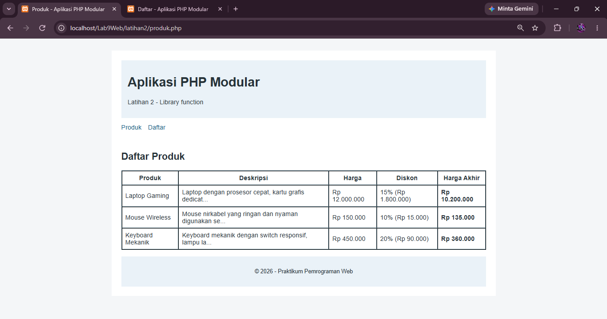

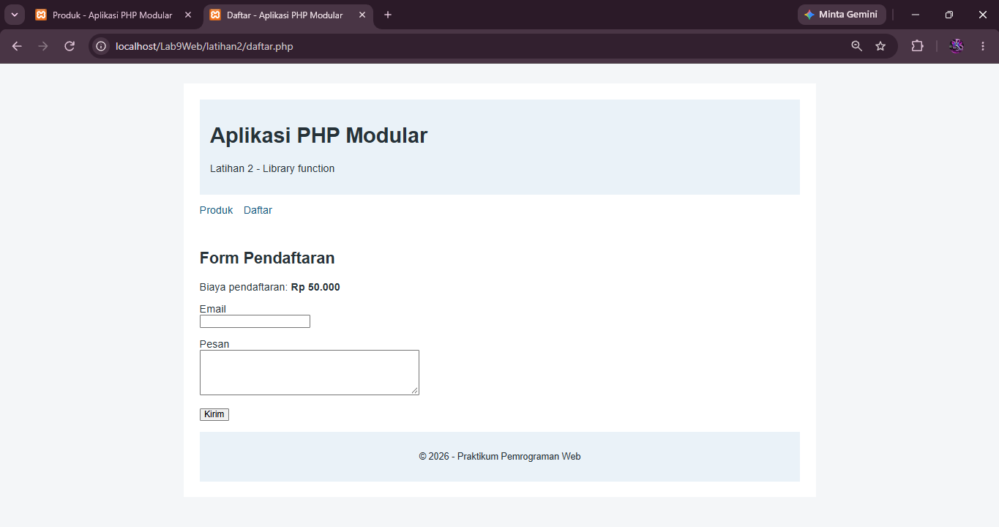

Email valid:

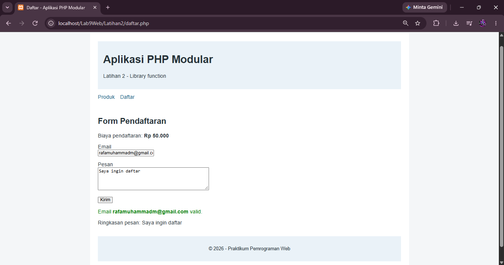

Email tidak valid:

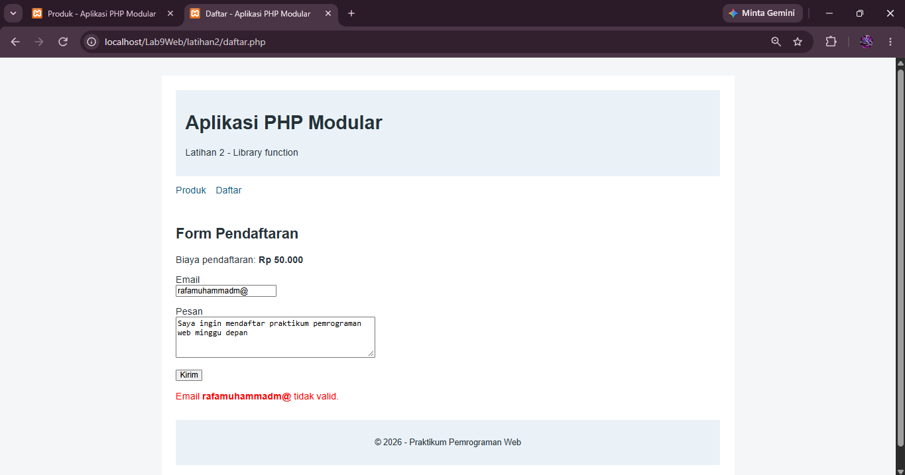

Pesan panjang diringkas:

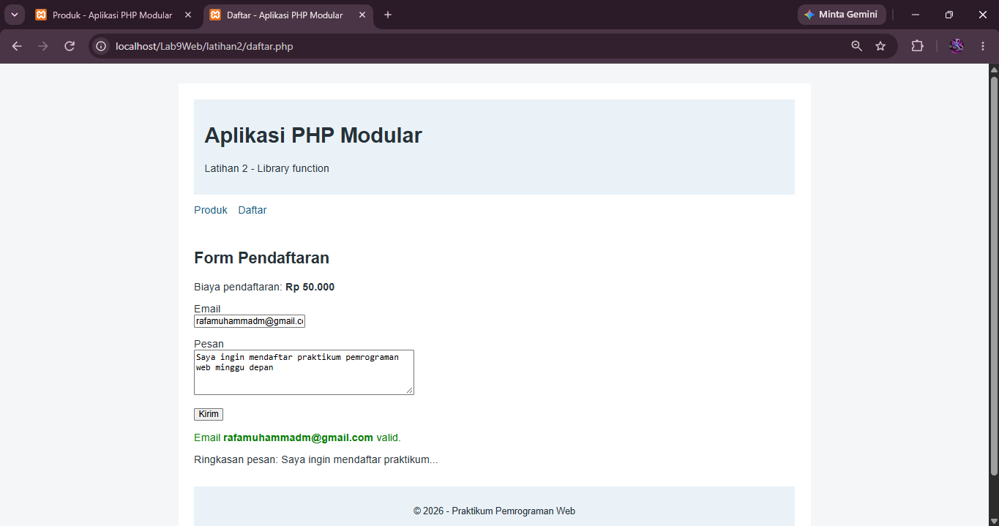

**Keterangan:**

Harga akhir pada halaman produk adalah Rp 10.200.000 (Laptop Gaming, diskon 15%), Rp 135.000 (Mouse Wireless, diskon 10%), dan Rp 360.000 (Keyboard Mekanik, diskon 20%). Deskripsi yang panjang dipotong menjadi 50 karakter dan diakhiri "...". Pada halaman daftar, email `rafamuhammadm@gmail.com` dinyatakan valid, sedangkan `rafamuhammadm@` tidak valid. Pesan yang lebih dari 30 karakter diringkas menjadi "Saya ingin mendaftar praktikum...". Function yang dipakai: `formatRupiah()` dan `e()` di kedua halaman, `hitungDiskon()` di `produk.php`, `ringkasTeks()` di kedua halaman, dan `validasiEmail()` di `daftar.php`.

---

### 7. Latihan 3 — Router Aman

**Tujuan:** Membuat router dengan minimal lima rute, halaman 404, dan memastikan input URL tidak dipakai langsung sebagai path file.

**Pembahasan:** Dibuat folder `Latihan3` dengan `index.php` sebagai titik masuk. Daftar rute disimpan pada array `$routes` (*whitelist*). Nilai `page` dari URL hanya dipakai sebagai kunci untuk mencari rute, sedangkan path file yang di-`require` selalu berasal dari daftar yang ditulis sendiri. Jika `page` bukan string (misalnya `page[]=x`) atau tidak terdaftar, status HTTP 404 dikirim dan halaman `views/404.php` ditampilkan. `helpers/functions.php` disalin dari Latihan 2.

**CODING (`index.php`):**

```php
<?php
require_once __DIR__ . '/helpers/functions.php';

// Whitelist rute: hanya halaman di daftar ini yang boleh dimuat
$routes = [
 'home' => ['file' => __DIR__ . '/views/home.php', 'judul' => 'Home'],
 'tentang' => ['file' => __DIR__ . '/views/tentang.php', 'judul' => 'Tentang'],
 'profil' => ['file' => __DIR__ . '/views/profil.php', 'judul' => 'Profil'],
 'produk' => ['file' => __DIR__ . '/views/produk.php', 'judul' => 'Produk'],
 'kontak' => ['file' => __DIR__ . '/views/kontak.php', 'judul' => 'Kontak'],
];

// Jika parameter page tidak ada, tampilkan home
$page = $_GET['page'] ?? 'home';

// Validasi: harus string dan terdaftar di whitelist
if (!is_string($page) || !array_key_exists($page, $routes)) {
 http_response_code(404);
 $judulHalaman = '404';
 $contentFile = __DIR__ . '/views/404.php';
} else {
 $judulHalaman = $routes[$page]['judul'];
 $contentFile = $routes[$page]['file'];
}

require_once __DIR__ . '/views/header.php';
require $contentFile;
require_once __DIR__ . '/views/footer.php';
?>
```

**CODING (`views/header.php`):**

```php
<?php
$judulHalaman = $judulHalaman ?? 'Latihan 3';
?>
<!DOCTYPE html>
<html lang="id">
<head>
 <meta charset="UTF-8">
 <meta name="viewport" content="width=device-width, initial-scale=1">
 <title><?php echo e($judulHalaman); ?> - Aplikasi PHP Modular</title>
 <link rel="stylesheet" href="style.css">
</head>
<body>
<div class="container">
 <header>
 <h1>Aplikasi PHP Modular</h1>
 <p>Latihan 3 - Router aman</p>
 </header>
 <nav>
 <a href="index.php?page=home">Home</a>
 <a href="index.php?page=tentang">Tentang</a>
 <a href="index.php?page=profil">Profil</a>
 <a href="index.php?page=produk">Produk</a>
 <a href="index.php?page=kontak">Kontak</a>
 </nav>
 <main>
```

**CODING (`views/footer.php`):**

```php
 </main>
 <footer>
 <p>&copy; <?php echo date('Y'); ?> - Praktikum Pemrograman Web</p>
 </footer>
</div>
</body>
</html>
```

**CODING (`views/404.php`):**

```php
<section class="content">
 <h2>404 - Halaman tidak ditemukan</h2>
 <p>Halaman yang diminta tidak tersedia.</p>
 <a href="index.php">Kembali ke Home</a>
</section>
```

**CODING (`views/home.php`):**

```php
<section class="content">
 <h2>Halaman Home</h2>
 <p>Selamat datang. Semua halaman dibuka lewat <code>index.php?page=...</code> dan dikendalikan oleh router.</p>
</section>
```

**CODING (`views/produk.php`):**

```php
<?php
$produk = [
 ['nama' => 'Laptop Gaming', 'harga' => 12000000],
 ['nama' => 'Mouse Wireless', 'harga' => 150000],
 ['nama' => 'Keyboard Mekanik', 'harga' => 450000],
];
?>
<section class="content">
 <h2>Daftar Produk</h2>
 <table border="1" cellpadding="8" cellspacing="0">
 <tr><th>Produk</th><th>Harga</th></tr>
 <?php foreach ($produk as $p): ?>
 <tr>
 <td><?php echo e($p['nama']); ?></td>
 <td><?php echo formatRupiah($p['harga']); ?></td>
 </tr>
 <?php endforeach; ?>
 </table>
</section>
```

File `views/tentang.php`, `views/profil.php`, dan `views/kontak.php` berisi konten halaman masing-masing (tanpa header/footer) dengan pola yang sama seperti `home.php`.

**Hasil Browser:**

Lima rute valid:

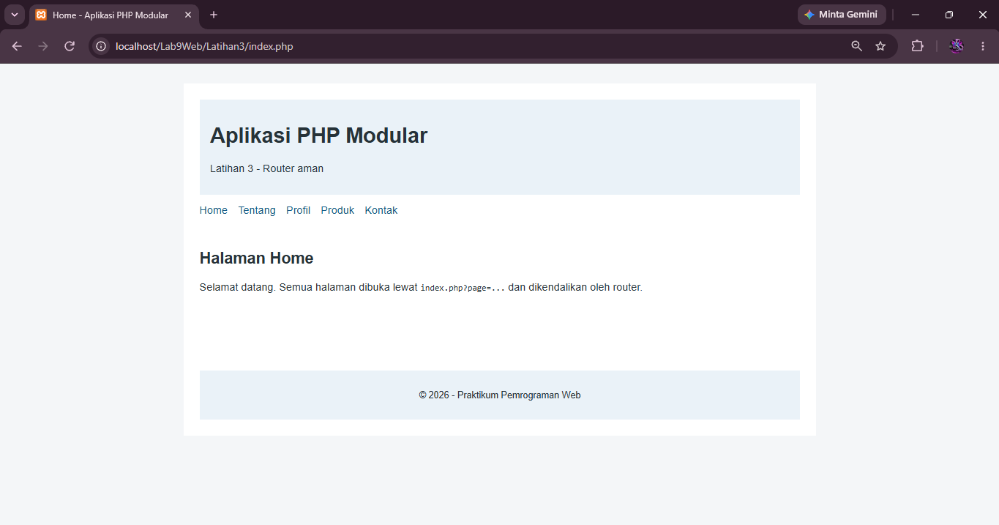

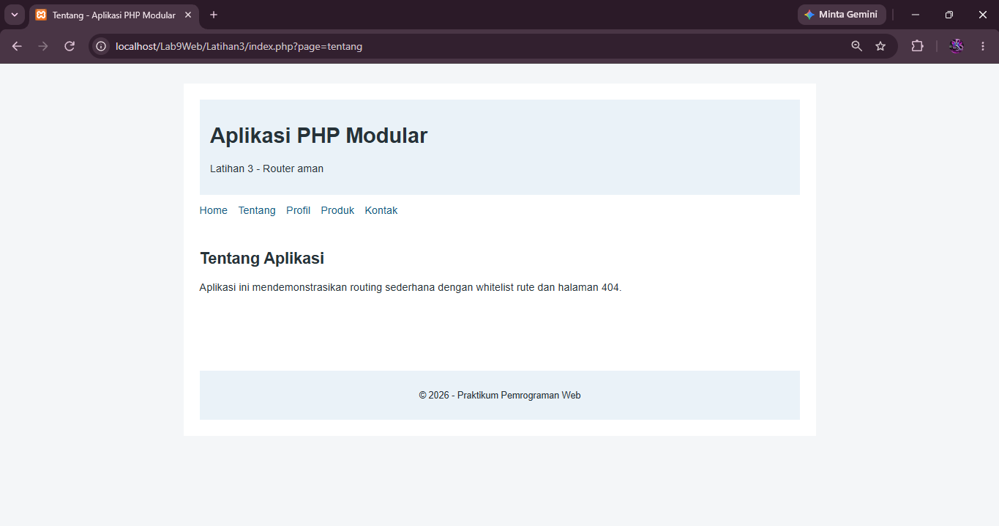

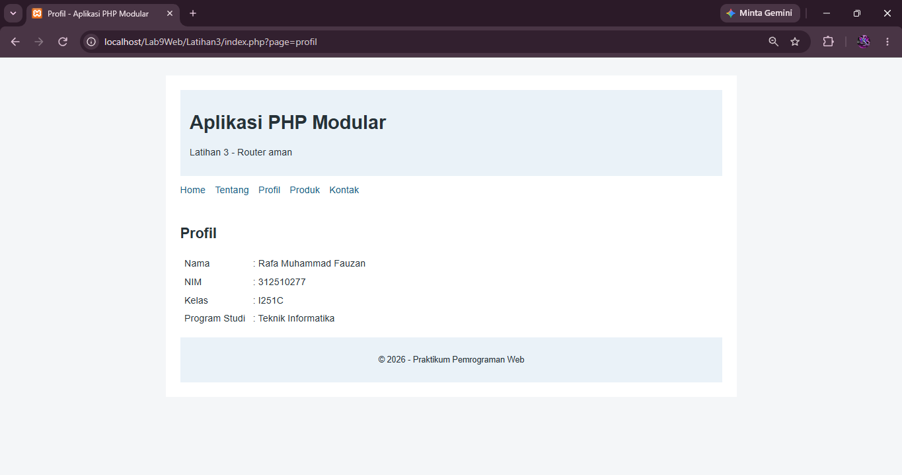

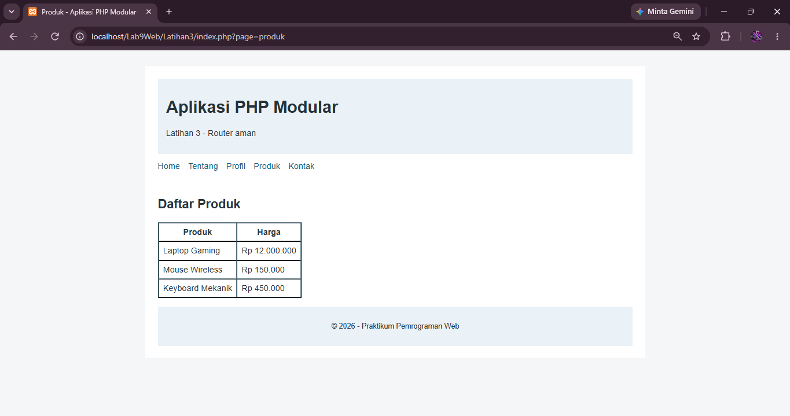

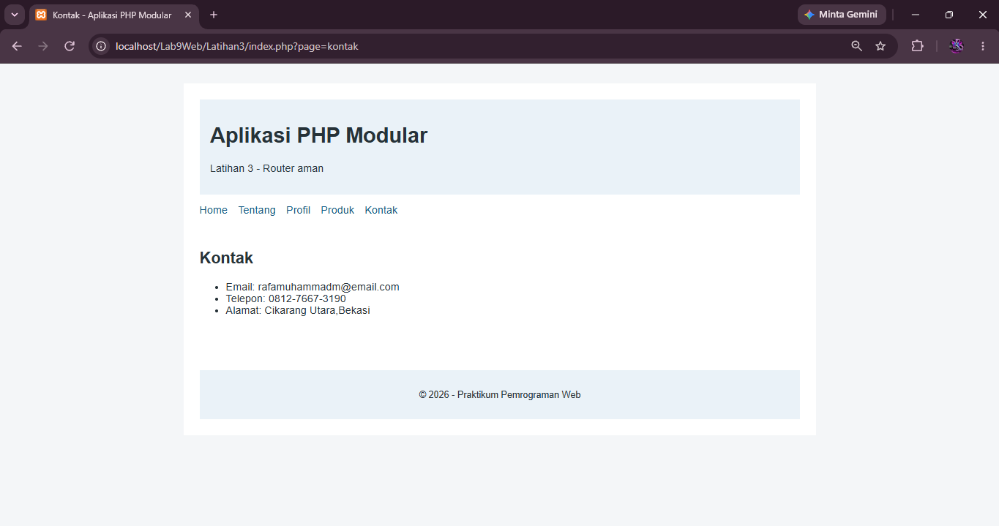

Rute tidak dikenal, parameter kosong, parameter bertipe array, dan percobaan *path traversal*:

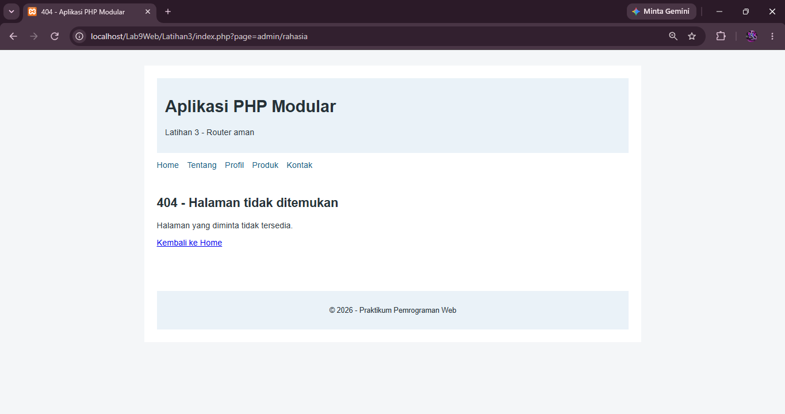

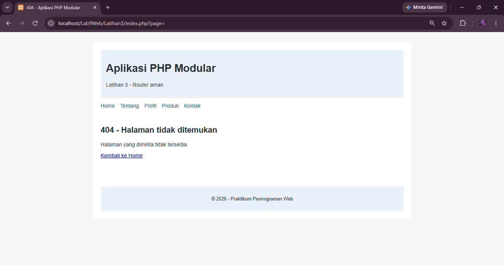


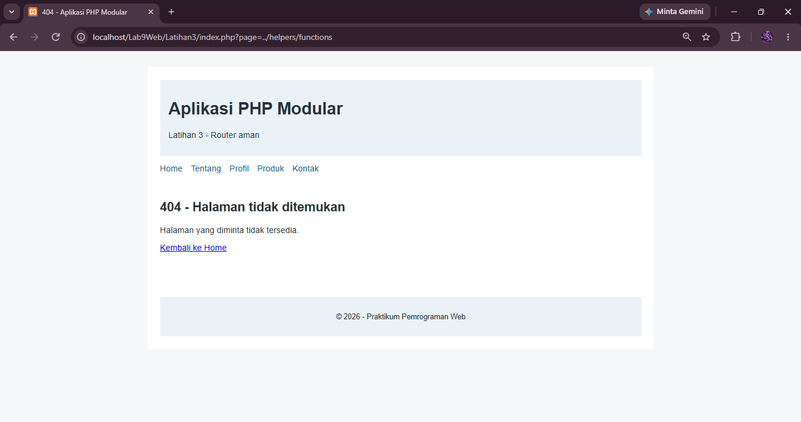

Status HTTP pada DevTools (tab Network):

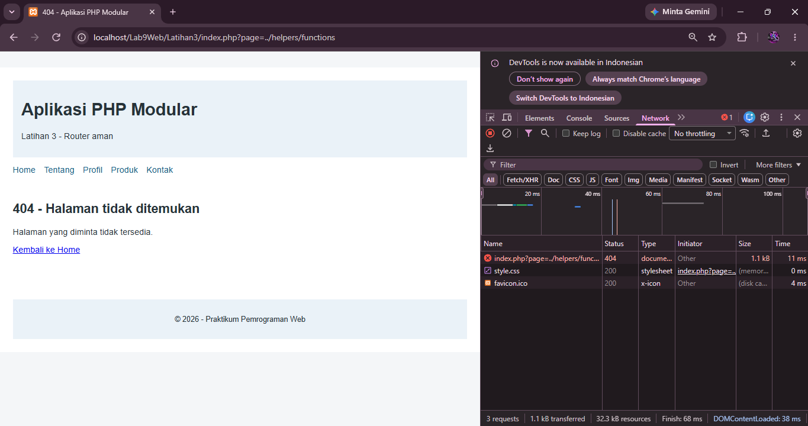

**Keterangan:**

Lima rute valid (`home`, `tentang`, `profil`, `produk`, `kontak`) tampil di dalam template yang sama. Pengujian `page=admin/rahasia`, `page=` (kosong), `page[]=x`, dan `page=../helpers/functions` semuanya menghasilkan halaman 404 dari router, dan DevTools menunjukkan status HTTP **404**. Dengan demikian kriteria terpenuhi: rute valid dapat diakses, rute tidak dikenal menghasilkan status 404, input URL tidak dipakai langsung sebagai path file, dan struktur kode mudah dibaca.

---

### 8. Latihan 4 — Refactoring CRUD

**Tujuan:** Menerapkan modularisasi pada aplikasi CRUD data barang dari Praktikum 8 sehingga semua halaman memakai template bersama dan diakses lewat router.

**Pembahasan:** Folder `lab8_php_database` disalin ke `Lab9Web` dan diberi nama `Latihan4` (folder asli tidak diubah). Folder `README.md` dan `images` dari Praktikum 8 dihapus dari salinan, lalu dibuat folder `config`, `views`, `helpers`, `modules/barang`, dan `assets/css`. File lama dipindahkan dan diganti nama sebagai berikut.

| File Praktikum 8 | Lokasi baru |
|---|---|
| `koneksi.php` | `config/database.php` |
| `index.php` (daftar barang) | `modules/barang/list.php` |
| `tambah.php` | `modules/barang/add.php` |
| `ubah.php` | `modules/barang/edit.php` |
| `hapus.php` | `modules/barang/delete.php` |
| `style.css` | `assets/css/style.css` |
| (baru) | `index.php` (router), `views/header.php`, `views/footer.php`, `views/404.php`, `helpers/functions.php` |

Perubahan pada isi file: koneksi hanya dimuat sekali oleh router, tag HTML pembuka/penutup dipindah ke `header.php` dan `footer.php`, semua tautan memakai pola `index.php?page=...`, redirect diarahkan ke `index.php?page=barang/list`, dan penghapusan data diubah dari tautan (GET) menjadi form dengan metode **POST**. Folder `gambar/` tetap di root `Latihan4`, sehingga path upload pada `add.php` dan `edit.php` memakai `dirname(__DIR__, 2)`. Ekstensi file gambar yang diunggah juga dibatasi (JPG, PNG, GIF, WEBP) dan nama barang divalidasi. Folder `helpers/functions.php` disalin dari Latihan 3.

**CODING (`config/database.php`):**

```php
<?php
// Koneksi database (dipindahkan dari koneksi.php Praktikum 8)
$host = "localhost";
$user = "root";
$pass = "";
$db   = "latihan1";

$conn = mysqli_connect($host, $user, $pass, $db);
if ($conn == false) {
    echo "Koneksi ke server gagal.";
    die();
}
?>
```

**CODING (`index.php` — router):**

```php
<?php
// Buffer output supaya redirect header('Location: ...') di modul tetap bisa jalan
ob_start();

require_once __DIR__ . '/config/database.php';
require_once __DIR__ . '/helpers/functions.php';

// Whitelist rute
$routes = [
 'barang/list' => ['file' => __DIR__ . '/modules/barang/list.php', 'judul' => 'Data Barang'],
 'barang/add' => ['file' => __DIR__ . '/modules/barang/add.php', 'judul' => 'Tambah Barang'],
 'barang/edit' => ['file' => __DIR__ . '/modules/barang/edit.php', 'judul' => 'Ubah Barang'],
 'barang/delete' => ['file' => __DIR__ . '/modules/barang/delete.php', 'judul' => 'Hapus Barang'],
];

$page = $_GET['page'] ?? 'barang/list';

if (!is_string($page) || !array_key_exists($page, $routes)) {
 http_response_code(404);
 $judulHalaman = '404';
 $contentFile = __DIR__ . '/views/404.php';
} else {
 $judulHalaman = $routes[$page]['judul'];
 $contentFile = $routes[$page]['file'];
}

require_once __DIR__ . '/views/header.php';
require $contentFile;
require_once __DIR__ . '/views/footer.php';

ob_end_flush();
?>
```

**CODING (`views/header.php`):**

```php
<?php
$judulHalaman = $judulHalaman ?? 'Data Barang';
?>
<!DOCTYPE html>
<html lang="id">
<head>
 <meta charset="UTF-8">
 <meta name="viewport" content="width=device-width, initial-scale=1">
 <title><?php echo e($judulHalaman); ?> - Aplikasi CRUD Modular</title>
 <link rel="stylesheet" href="assets/css/style.css">
</head>
<body>
<div class="container">
 <header>
 <h1>Aplikasi CRUD Modular</h1>
 <p>Latihan 4 - Refactoring CRUD</p>
 </header>
 <nav>
 <a href="index.php?page=barang/list">Data Barang</a>
 <a href="index.php?page=barang/add">Tambah Barang</a>
 </nav>
 <main>
```

`views/footer.php` dan `views/404.php` sama seperti pada Latihan 3.

**CODING (`modules/barang/list.php`):**

```php
<?php
// Koneksi ($conn) dan helper (e, formatRupiah) sudah dimuat oleh router index.php
$sql = 'SELECT * FROM data_barang';
$result = mysqli_query($conn, $sql);
?>
<h2>Data Barang</h2>
<div class="main">
    <table>
        <tr>
            <th>Gambar</th>
            <th>Nama Barang</th>
            <th>Kategori</th>
            <th>Harga Beli</th>
            <th>Harga Jual</th>
            <th>Stok</th>
            <th>Aksi</th>
        </tr>
        <?php if ($result && mysqli_num_rows($result) > 0): ?>
        <?php while ($row = mysqli_fetch_assoc($result)): ?>
        <tr>
            <td>
                <?php if (!empty($row['gambar'])): ?>
                " alt="<?= e($row['nama']); ?>">
                <?php endif; ?>
            </td>
            <td><?= e($row['nama']); ?></td>
            <td><?= e($row['kategori']); ?></td>
            <td><?= formatRupiah($row['harga_beli']); ?></td>
            <td><?= formatRupiah($row['harga_jual']); ?></td>
            <td><?= (int) $row['stok']; ?></td>
            <td>
                <a href="index.php?page=barang/edit&id=<?= (int) $row['id_barang']; ?>">Ubah</a>
                <form method="post" action="index.php?page=barang/delete" style="display:inline"
                      onsubmit="return confirm('Hapus data ini?')">
                    <input type="hidden" name="id" value="<?= (int) $row['id_barang']; ?>">
                    <button type="submit">Hapus</button>
                </form>
            </td>
        </tr>
        <?php endwhile; else: ?>
        <tr>
            <td colspan="7">Belum ada data</td>
        </tr>
        <?php endif; ?>
    </table>
</div>
```

**CODING (`modules/barang/add.php`):**

```php
<?php
// Koneksi ($conn) dan helper (e) sudah dimuat oleh router index.php
$error = '';

if (isset($_POST['submit'])) {
    $nama       = trim($_POST['nama'] ?? '');
    $kategori   = $_POST['kategori'] ?? '';
    $harga_jual = (int) ($_POST['harga_jual'] ?? 0);
    $harga_beli = (int) ($_POST['harga_beli'] ?? 0);
    $stok       = (int) ($_POST['stok'] ?? 0);
    $gambar     = null;

    if ($nama === '') {
        $error = 'Nama barang wajib diisi.';
    }

    if ($error === '' && isset($_FILES['file_gambar']) && $_FILES['file_gambar']['error'] == 0) {
        $file_gambar = $_FILES['file_gambar'];
        $filename = str_replace(' ', '_', basename($file_gambar['name']));
        $ext = strtolower(pathinfo($filename, PATHINFO_EXTENSION));

        if (!in_array($ext, ['jpg', 'jpeg', 'png', 'gif', 'webp'], true)) {
            $error = 'Format gambar harus JPG, PNG, GIF, atau WEBP.';
        } else {
            // Naik dua tingkat: modules/barang -> root Latihan4
            $destination = dirname(__DIR__, 2) . '/gambar/' . $filename;
            if (move_uploaded_file($file_gambar['tmp_name'], $destination)) {
                $gambar = $filename; // simpan nama file saja
            }
        }
    }

    if ($error === '') {
        $stmt = mysqli_prepare($conn,
            "INSERT INTO data_barang (kategori, nama, gambar, harga_beli, harga_jual, stok)
             VALUES (?, ?, ?, ?, ?, ?)");
        mysqli_stmt_bind_param($stmt, "sssiii", $kategori, $nama, $gambar, $harga_beli, $harga_jual, $stok);
        mysqli_stmt_execute($stmt);

        header('Location: index.php?page=barang/list');
        exit;
    }
}
?>
<h2>Tambah Barang</h2>
<div class="main">
    <?php if ($error !== ''): ?>
    <p style="color: red;"><?= e($error); ?></p>
    <?php endif; ?>

    <form method="post" action="index.php?page=barang/add" enctype="multipart/form-data">
        <div class="input">
            <label>Nama Barang</label>
            <input type="text" name="nama" />
        </div>
        <div class="input">
            <label>Kategori</label>
            <select name="kategori">
                <option value="Komputer">Komputer</option>
                <option value="Elektronik">Elektronik</option>
                <option value="Hand Phone">Hand Phone</option>
            </select>
        </div>
        <div class="input">
            <label>Harga Jual</label>
            <input type="text" name="harga_jual" />
        </div>
        <div class="input">
            <label>Harga Beli</label>
            <input type="text" name="harga_beli" />
        </div>
        <div class="input">
            <label>Stok</label>
            <input type="text" name="stok" />
        </div>
        <div class="input">
            <label>File Gambar</label>
            <input type="file" name="file_gambar" />
        </div>
        <div class="submit">
            <input type="submit" name="submit" value="Simpan" />
        </div>
    </form>
</div>
```

**CODING (`modules/barang/edit.php`):**

```php
<?php
// Koneksi ($conn) dan helper (e) sudah dimuat oleh router index.php
$error = '';
$daftarKategori = ['Komputer', 'Elektronik', 'Hand Phone'];

if (isset($_POST['submit'])) {
    $id         = (int) ($_POST['id'] ?? 0);
    $nama       = trim($_POST['nama'] ?? '');
    $kategori   = $_POST['kategori'] ?? '';
    $harga_jual = (int) ($_POST['harga_jual'] ?? 0);
    $harga_beli = (int) ($_POST['harga_beli'] ?? 0);
    $stok       = (int) ($_POST['stok'] ?? 0);
    $gambar     = null;

    if ($nama === '') {
        $error = 'Nama barang wajib diisi.';
    }

    if ($error === '' && isset($_FILES['file_gambar']) && $_FILES['file_gambar']['error'] == 0) {
        $file_gambar = $_FILES['file_gambar'];
        $filename = str_replace(' ', '_', basename($file_gambar['name']));
        $ext = strtolower(pathinfo($filename, PATHINFO_EXTENSION));

        if (!in_array($ext, ['jpg', 'jpeg', 'png', 'gif', 'webp'], true)) {
            $error = 'Format gambar harus JPG, PNG, GIF, atau WEBP.';
        } else {
            // Naik dua tingkat: modules/barang -> root Latihan4
            $destination = dirname(__DIR__, 2) . '/gambar/' . $filename;
            if (move_uploaded_file($file_gambar['tmp_name'], $destination)) {
                $gambar = $filename;
            }
        }
    }

    if ($error === '') {
        if (!empty($gambar)) {
            $stmt = mysqli_prepare($conn,
                "UPDATE data_barang SET nama=?, kategori=?, harga_jual=?, harga_beli=?, stok=?, gambar=? WHERE id_barang=?");
            mysqli_stmt_bind_param($stmt, "ssiiisi", $nama, $kategori, $harga_jual, $harga_beli, $stok, $gambar, $id);
        } else {
            $stmt = mysqli_prepare($conn,
                "UPDATE data_barang SET nama=?, kategori=?, harga_jual=?, harga_beli=?, stok=? WHERE id_barang=?");
            mysqli_stmt_bind_param($stmt, "ssiiii", $nama, $kategori, $harga_jual, $harga_beli, $stok, $id);
        }
        mysqli_stmt_execute($stmt);

        header('Location: index.php?page=barang/list');
        exit;
    }
}

// Ambil data barang yang akan diubah (dari POST jika form gagal divalidasi, selain itu dari GET)
$id = (int) ($_POST['id'] ?? $_GET['id'] ?? 0);
$stmt = mysqli_prepare($conn, "SELECT * FROM data_barang WHERE id_barang = ?");
mysqli_stmt_bind_param($stmt, "i", $id);
mysqli_stmt_execute($stmt);
$result = mysqli_stmt_get_result($stmt);
$data = mysqli_fetch_assoc($result);
?>
<h2>Ubah Barang</h2>
<div class="main">
    <?php if (!$data): ?>
    <p>Data tidak tersedia.</p>
    <p><a href="index.php?page=barang/list">Kembali ke Data Barang</a></p>
    <?php else: ?>
    <?php if ($error !== ''): ?>
    <p style="color: red;"><?= e($error); ?></p>
    <?php endif; ?>

    <form method="post" action="index.php?page=barang/edit" enctype="multipart/form-data">
        <div class="input">
            <label>Nama Barang</label>
            <input type="text" name="nama" value="<?= e($data['nama']); ?>" />
        </div>
        <div class="input">
            <label>Kategori</label>
            <select name="kategori">
                <?php foreach ($daftarKategori as $k): ?>
                <option value="<?= e($k); ?>" <?= $data['kategori'] === $k ? 'selected="selected"' : ''; ?>><?= e($k); ?></option>
                <?php endforeach; ?>
            </select>
        </div>
        <div class="input">
            <label>Harga Jual</label>
            <input type="text" name="harga_jual" value="<?= (int) $data['harga_jual']; ?>" />
        </div>
        <div class="input">
            <label>Harga Beli</label>
            <input type="text" name="harga_beli" value="<?= (int) $data['harga_beli']; ?>" />
        </div>
        <div class="input">
            <label>Stok</label>
            <input type="text" name="stok" value="<?= (int) $data['stok']; ?>" />
        </div>
        <div class="input">
            <label>File Gambar</label>
            <input type="file" name="file_gambar" />
        </div>
        <div class="submit">
            <input type="hidden" name="id" value="<?= (int) $data['id_barang']; ?>" />
            <input type="submit" name="submit" value="Simpan" />
        </div>
    </form>
    <?php endif; ?>
</div>
```

**CODING (`modules/barang/delete.php`):**

```php
<?php
// Koneksi ($conn) sudah dimuat oleh router index.php
// Hapus data hanya boleh lewat POST (bukan dengan membuka URL biasa / GET)
if ($_SERVER['REQUEST_METHOD'] === 'POST') {
    $id = (int) ($_POST['id'] ?? 0);

    if ($id > 0) {
        $stmt = mysqli_prepare($conn, "DELETE FROM data_barang WHERE id_barang = ?");
        mysqli_stmt_bind_param($stmt, "i", $id);
        mysqli_stmt_execute($stmt);
    }
}

// Baik berhasil maupun dibuka lewat GET, kembali ke daftar barang
header('Location: index.php?page=barang/list');
exit;
?>
```

**Hasil Browser:**

Struktur direktori:

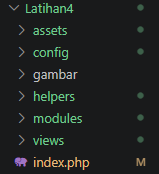

Daftar barang (Read):

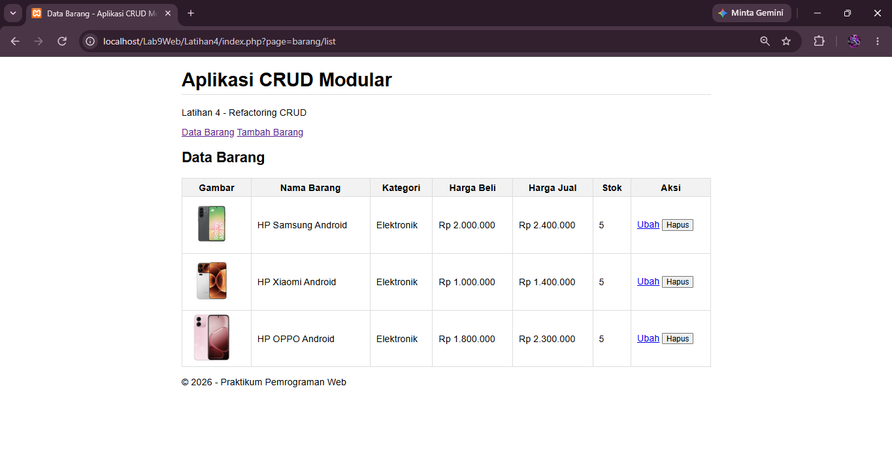

Tambah barang (Create):

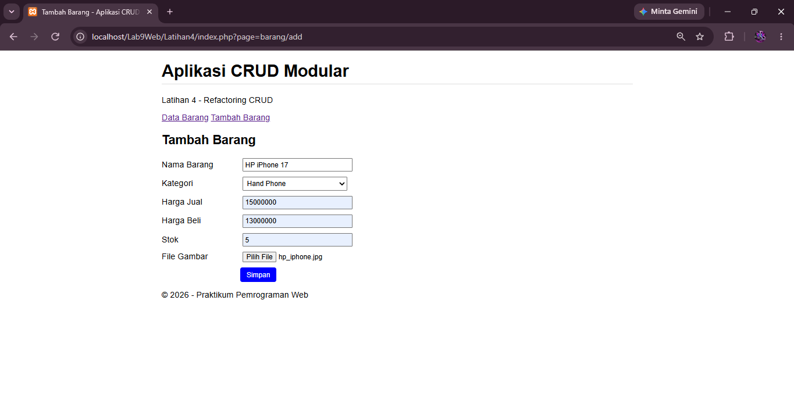

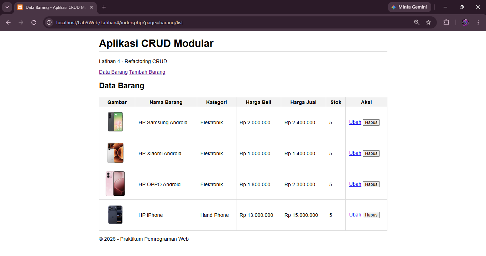

Ubah barang (Update):

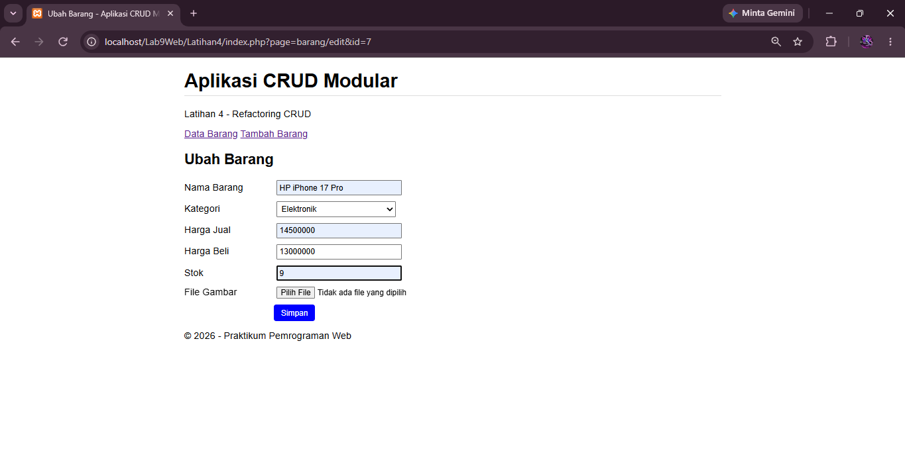


Hapus barang (Delete):

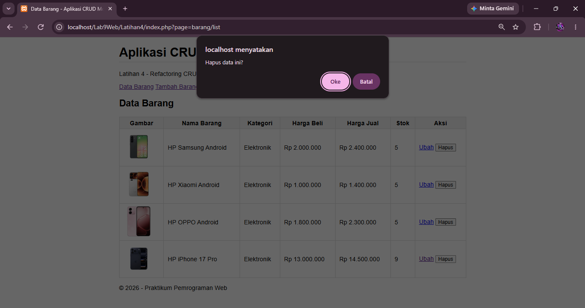


Membuka URL hapus lewat GET (tidak menghapus data, hanya redirect 302):

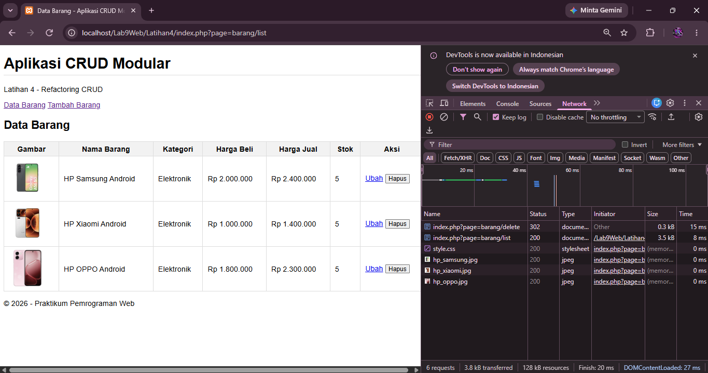

Rute tidak dikenal:

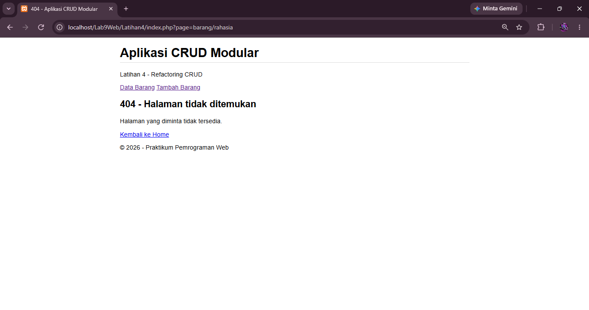

**Keterangan:**

Seluruh fitur CRUD tetap berjalan melalui router. Pada pengujian, data HP iPhone berhasil ditambahkan, diubah (nama, harga jual, dan stok berubah), lalu dihapus setelah dialog konfirmasi. Saat `index.php?page=barang/delete` dibuka langsung di address bar (GET), DevTools menunjukkan status 302 menuju daftar barang dan tidak ada data yang terhapus, sehingga penghapusan benar-benar hanya bisa dilakukan lewat POST. Kriteria Latihan 4 terpenuhi: operasi CRUD tetap berjalan, koneksi database hanya dikelola di satu file (`config/database.php`), dan tautan antarhalaman memakai routing.

---

### 9. Tantangan Mandiri 1 — Menu Aktif

**Tujuan:** Menandai menu navigasi sesuai halaman yang sedang dibuka.

**Pembahasan:** Folder `Latihan4` disalin menjadi `Tantangan` agar bukti Latihan 4 tetap utuh. Ditambahkan function `menuAktif()` yang mengembalikan kelas `active` jika rute menu sama dengan halaman saat ini. Variabel `$page` dari router dipastikan bertipe string terlebih dahulu pada `header.php` karena parameter `page[]=x` menghasilkan array.

**CODING (tambahan pada `helpers/functions.php`):**

```php
// Mengembalikan 'active' jika rute menu sama dengan halaman yang sedang dibuka
function menuAktif(string $rute, string $halamanSekarang): string {
 return $rute === $halamanSekarang ? 'active' : '';
}
```

**CODING (bagian `<nav>` pada `views/header.php`):**

```php
<?php
// $page dari router bisa berupa array (misal ?page[]=x), jadi pastikan string dulu
$halamanAktif = (isset($page) && is_string($page)) ? $page : '';
?>
...
 <nav>
 <a href="index.php?page=barang/list" class="<?= menuAktif('barang/list', $halamanAktif); ?>">Data Barang</a>
 <a href="index.php?page=barang/add" class="<?= menuAktif('barang/add', $halamanAktif); ?>">Tambah Barang</a>
 </nav>
```

**CODING (tambahan pada `assets/css/style.css`):**

```css
nav a.active {
 font-weight: bold;
 text-decoration: none;
 color: #fff;
 background: #145a86;
 padding: 4px 10px;
 border-radius: 4px;
}
```

**Hasil Browser:**

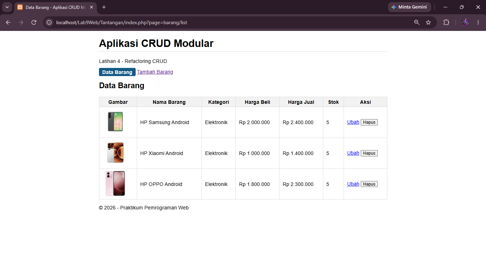

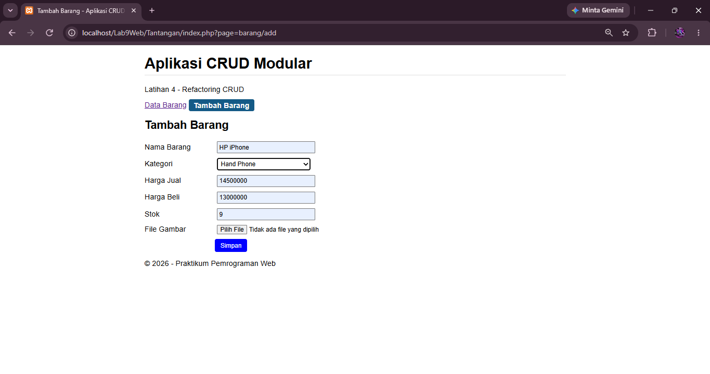

**Keterangan:**

Menu "Data Barang" ditandai (latar biru) saat daftar barang dibuka, dan penanda berpindah ke "Tambah Barang" saat halaman tambah dibuka. Pada halaman 404 dan halaman edit tidak ada menu yang ditandai karena halaman tersebut tidak memiliki menu sendiri.

---

### 10. Tantangan Mandiri 2 — Helper Pesan Sukses dan Gagal

**Tujuan:** Menampilkan pesan sukses atau gagal setelah operasi tambah, ubah, dan hapus.

**Pembahasan:** Karena setiap operasi diakhiri *redirect*, pesan tidak bisa dikirim lewat variabel biasa. Pesan disimpan sementara di `$_SESSION` oleh `setPesan()`, lalu diambil dan langsung dihapus oleh `tampilkanPesan()` sehingga hanya tampil sekali. Router memanggil `session_start()` dan menampilkan pesan di satu tempat. Operasi database dibungkus `try/catch` agar kegagalan menghasilkan pesan merah. Penghapusan memakai `mysqli_stmt_affected_rows()` untuk membedakan data yang berhasil dihapus dan data yang tidak ditemukan.

**CODING (tambahan pada `helpers/functions.php`):**

```php
// Simpan pesan untuk ditampilkan di halaman berikutnya. $tipe: 'sukses' atau 'gagal'
function setPesan(string $tipe, string $teks): void {
 $_SESSION['pesan'] = ['tipe' => $tipe, 'teks' => $teks];
}

// Ambil pesan (kalau ada), tampilkan, lalu hapus supaya hanya muncul sekali
function tampilkanPesan(): string {
 if (empty($_SESSION['pesan'])) {
 return '';
 }
 $p = $_SESSION['pesan'];
 unset($_SESSION['pesan']);
 $kelas = $p['tipe'] === 'sukses' ? 'pesan-sukses' : 'pesan-gagal';
 return '<div class="pesan ' . $kelas . '">' . e($p['teks']) . '</div>';
}
```

**CODING (perubahan pada `index.php`):**

```php
ob_start();
session_start();
...
require_once __DIR__ . '/views/header.php';
echo tampilkanPesan();
require $contentFile;
require_once __DIR__ . '/views/footer.php';
```

**CODING (perubahan pada `modules/barang/add.php`, dengan pola yang sama pada `edit.php`):**

```php
        try {
            mysqli_stmt_execute($stmt);
            setPesan('sukses', 'Barang berhasil ditambahkan.');
        } catch (mysqli_sql_exception $ex) {
            error_log($ex->getMessage());
            setPesan('gagal', 'Barang gagal ditambahkan.');
        }

        header('Location: index.php?page=barang/list');
```

Pada `edit.php`, pesan yang dipakai adalah "Barang berhasil diubah." dan "Barang gagal diubah.".

**CODING (`modules/barang/delete.php`):**

```php
<?php
// Hapus data hanya boleh lewat POST (bukan dengan membuka URL biasa / GET)
if ($_SERVER['REQUEST_METHOD'] === 'POST') {
    $id = (int) ($_POST['id'] ?? 0);

    if ($id > 0) {
        try {
            $stmt = mysqli_prepare($conn, "DELETE FROM data_barang WHERE id_barang = ?");
            mysqli_stmt_bind_param($stmt, "i", $id);
            mysqli_stmt_execute($stmt);

            if (mysqli_stmt_affected_rows($stmt) > 0) {
                setPesan('sukses', 'Barang berhasil dihapus.');
            } else {
                setPesan('gagal', 'Data tidak ditemukan.');
            }
        } catch (mysqli_sql_exception $ex) {
            error_log($ex->getMessage());
            setPesan('gagal', 'Barang gagal dihapus.');
        }
    }
}

header('Location: index.php?page=barang/list');
exit;
?>
```

**CODING (tambahan pada `assets/css/style.css`):**

```css
.pesan {
 padding: 10px 14px;
 margin: 12px 0;
 border-radius: 4px;
 border: 1px solid;
}
.pesan-sukses {
 background: #e8f5e9;
 border-color: #2e7d32;
 color: #1b5e20;
}
.pesan-gagal {
 background: #fdecea;
 border-color: #c62828;
 color: #b71c1c;
}
```

**Hasil Browser:**

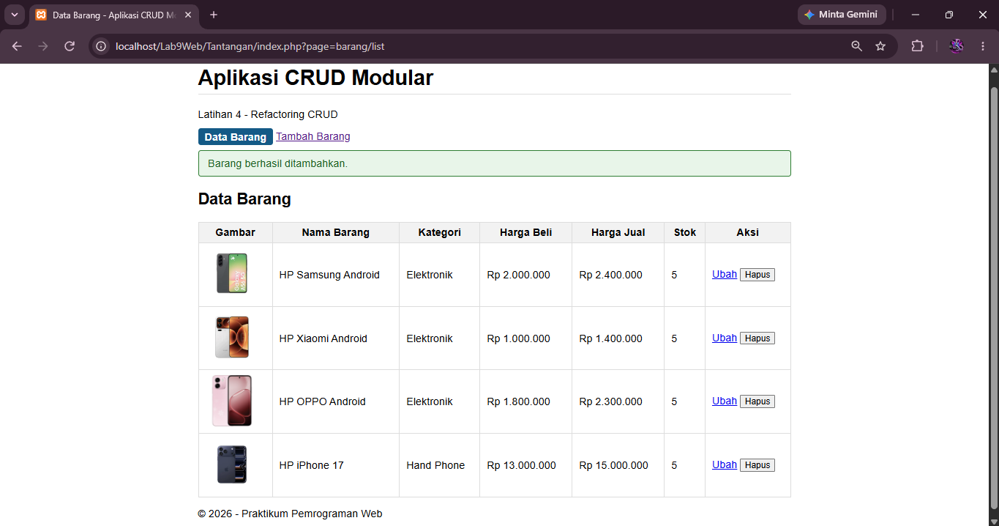

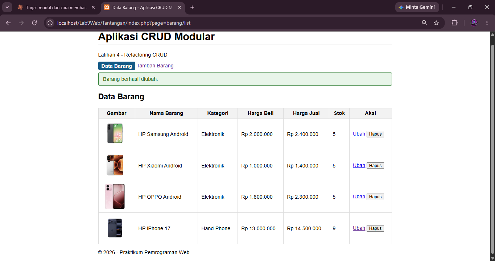

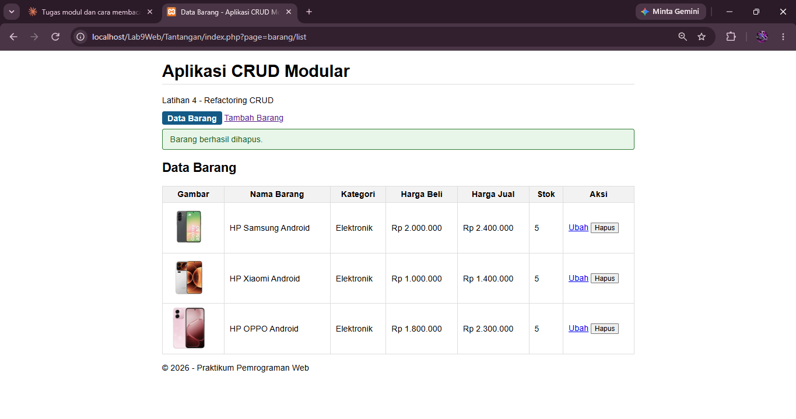

**Keterangan:**

Pesan hijau tampil setelah operasi berhasil dan hilang saat halaman di-refresh. Pesan merah dipakai untuk kegagalan atau data yang tidak ditemukan.

---

### 11. Tantangan Mandiri 3 — Pembatasan Akses Login

**Tujuan:** Membatasi akses halaman barang hanya untuk pengguna yang sudah login.

**Pembahasan:** Dibuat tabel `users` dan akun uji dengan skrip `setup_user.php` yang dijalankan sekali lalu **dihapus**. Password disimpan sebagai *hash* (`password_hash()`) dan diperiksa dengan `password_verify()`. Pada router, setiap rute memiliki penanda `publik`. Rute yang tidak publik hanya bisa dibuka jika `sudahLogin()` bernilai benar, selain itu pengguna dialihkan ke halaman login. Setelah login berhasil, ID sesi diganti dengan `session_regenerate_id(true)`. Logout dilakukan lewat tombol dengan metode POST. Perlindungan CSRF belum diterapkan pada versi ini dan dapat dikembangkan pada materi autentikasi berikutnya.

**CODING (`setup_user.php`, dijalankan sekali lalu dihapus):**

```php
<?php
require_once __DIR__ . '/config/database.php';

mysqli_query($conn, "CREATE TABLE IF NOT EXISTS users (
    id INT AUTO_INCREMENT PRIMARY KEY,
    username VARCHAR(50) NOT NULL UNIQUE,
    password VARCHAR(255) NOT NULL
)");

$username = 'admin';
$hash = password_hash('admin123', PASSWORD_DEFAULT);

$stmt = mysqli_prepare($conn, "INSERT IGNORE INTO users (username, password) VALUES (?, ?)");
mysqli_stmt_bind_param($stmt, "ss", $username, $hash);
mysqli_stmt_execute($stmt);

echo 'Selesai. Akun: admin / admin123. Hapus file ini sekarang.';
```

**CODING (tambahan pada `helpers/functions.php`):**

```php
// Cek apakah pengguna sudah login
function sudahLogin(): bool {
 return !empty($_SESSION['user']);
}
```

**CODING (`index.php`, versi dengan pengecekan login):**

```php
<?php
ob_start();
session_start();

require_once __DIR__ . '/config/database.php';
require_once __DIR__ . '/helpers/functions.php';

// Whitelist rute. 'publik' => true berarti boleh dibuka tanpa login
$routes = [
 'barang/list' => ['file' => __DIR__ . '/modules/barang/list.php', 'judul' => 'Data Barang', 'publik' => false],
 'barang/add' => ['file' => __DIR__ . '/modules/barang/add.php', 'judul' => 'Tambah Barang', 'publik' => false],
 'barang/edit' => ['file' => __DIR__ . '/modules/barang/edit.php', 'judul' => 'Ubah Barang', 'publik' => false],
 'barang/delete' => ['file' => __DIR__ . '/modules/barang/delete.php', 'judul' => 'Hapus Barang', 'publik' => false],
 'auth/login' => ['file' => __DIR__ . '/modules/auth/login.php', 'judul' => 'Login', 'publik' => true],
 'auth/logout' => ['file' => __DIR__ . '/modules/auth/logout.php', 'judul' => 'Logout', 'publik' => false],
];

$page = $_GET['page'] ?? 'barang/list';

if (!is_string($page) || !array_key_exists($page, $routes)) {
 http_response_code(404);
 $judulHalaman = '404';
 $contentFile = __DIR__ . '/views/404.php';
} else {
 // Halaman yang tidak publik wajib login
 if (empty($routes[$page]['publik']) && !sudahLogin()) {
 setPesan('gagal', 'Silakan login terlebih dahulu.');
 header('Location: index.php?page=auth/login');
 exit;
 }
 $judulHalaman = $routes[$page]['judul'];
 $contentFile = $routes[$page]['file'];
}

require_once __DIR__ . '/views/header.php';
echo tampilkanPesan();
require $contentFile;
require_once __DIR__ . '/views/footer.php';

ob_end_flush();
?>
```

**CODING (`modules/auth/login.php`):**

```php
<?php
if (sudahLogin()) {
    header('Location: index.php?page=barang/list');
    exit;
}

$error = '';

if ($_SERVER['REQUEST_METHOD'] === 'POST') {
    $username = trim($_POST['username'] ?? '');
    $password = $_POST['password'] ?? '';

    $stmt = mysqli_prepare($conn, "SELECT id, username, password FROM users WHERE username = ?");
    mysqli_stmt_bind_param($stmt, "s", $username);
    mysqli_stmt_execute($stmt);
    $user = mysqli_fetch_assoc(mysqli_stmt_get_result($stmt));

    if ($user && password_verify($password, $user['password'])) {
        session_regenerate_id(true);
        $_SESSION['user'] = ['id' => (int) $user['id'], 'username' => $user['username']];
        setPesan('sukses', 'Login berhasil.');
        header('Location: index.php?page=barang/list');
        exit;
    }
    $error = 'Username atau password salah.';
}
?>
<h2>Login</h2>
<div class="main">
    <?php if ($error !== ''): ?>
    <p style="color: red;"><?= e($error); ?></p>
    <?php endif; ?>

    <form method="post" action="index.php?page=auth/login">
        <div class="input">
            <label>Username</label>
            <input type="text" name="username" value="<?= e($_POST['username'] ?? ''); ?>" />
        </div>
        <div class="input">
            <label>Password</label>
            <input type="password" name="password" />
        </div>
        <div class="submit">
            <input type="submit" value="Login" />
        </div>
    </form>
</div>
```

**CODING (`modules/auth/logout.php`):**

```php
<?php
// Logout hanya lewat POST (tombol di header)
if ($_SERVER['REQUEST_METHOD'] === 'POST') {
    unset($_SESSION['user']);
    session_regenerate_id(true);
    setPesan('sukses', 'Anda telah logout.');
}

header('Location: index.php?page=auth/login');
exit;
```

**CODING (bagian `<nav>` pada `views/header.php`):**

```php
 <nav>
 <?php if (sudahLogin()): ?>
 <a href="index.php?page=barang/list" class="<?= menuAktif('barang/list', $halamanAktif); ?>">Data Barang</a>
 <a href="index.php?page=barang/add" class="<?= menuAktif('barang/add', $halamanAktif); ?>">Tambah Barang</a>
 <form method="post" action="index.php?page=auth/logout" style="display:inline">
 <span>Masuk sebagai <strong><?= e($_SESSION['user']['username']); ?></strong></span>
 <button type="submit">Logout</button>
 </form>
 <?php else: ?>
 <a href="index.php?page=auth/login" class="<?= menuAktif('auth/login', $halamanAktif); ?>">Login</a>
 <?php endif; ?>
 </nav>
```

**Hasil Browser:**

Skrip pembuat akun dijalankan sekali:

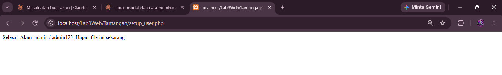

Membuka halaman barang tanpa login dialihkan ke Login (status 302):

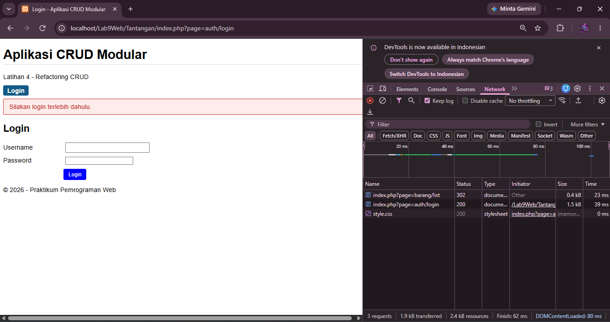

Login dengan password salah:

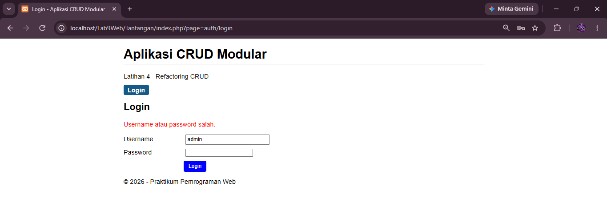

Login berhasil:

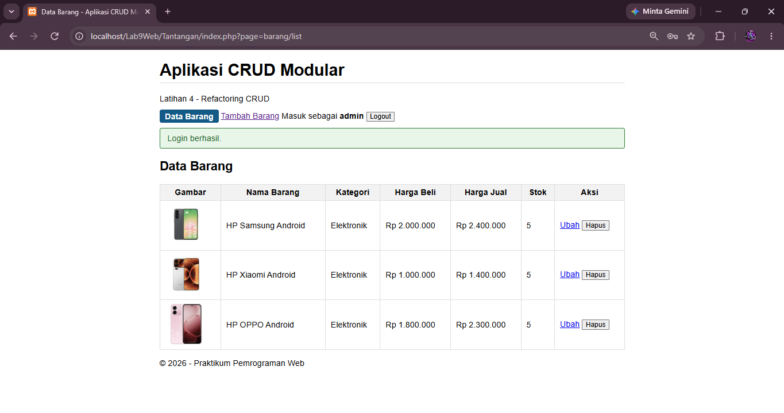

Halaman tambah barang setelah login:

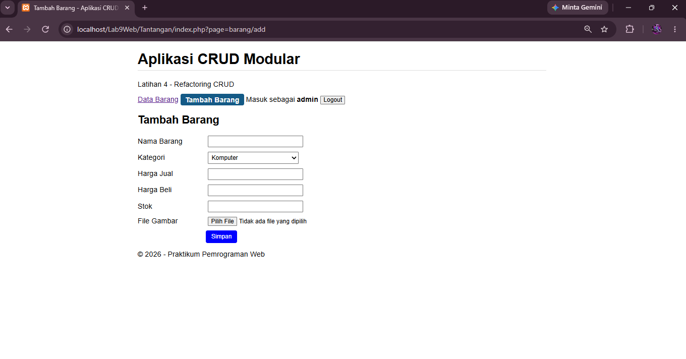

Logout:

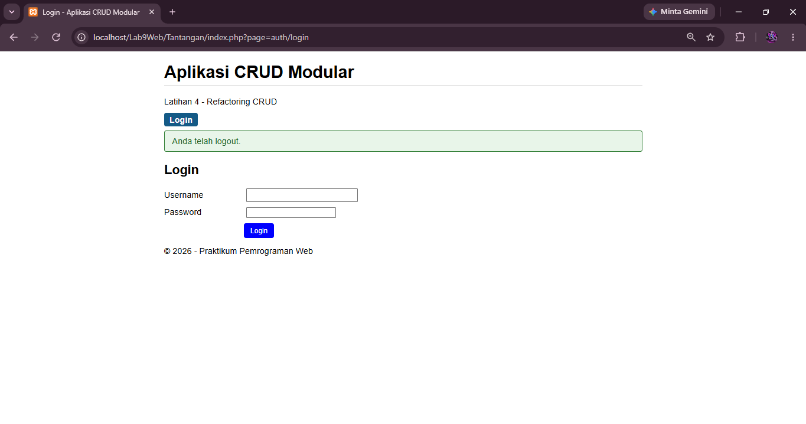

Halaman barang dibuka lagi setelah logout (tetap dialihkan ke Login):

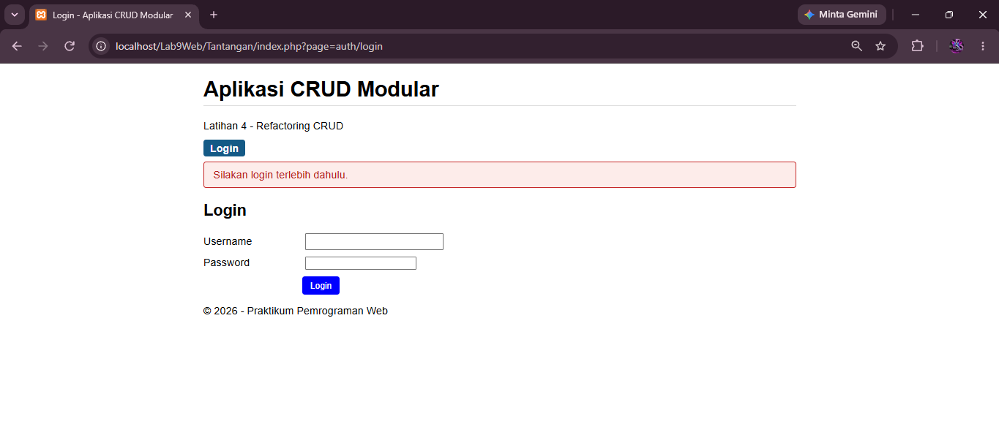

**Keterangan:**

Tanpa login, membuka `barang/add` maupun `barang/list` menghasilkan status 302 menuju halaman Login dengan pesan "Silakan login terlebih dahulu." Login dengan password salah menampilkan "Username atau password salah." Login dengan akun `admin` berhasil, menu menampilkan "Masuk sebagai admin" dan tombol Logout. Setelah logout, halaman barang kembali terkunci. File `setup_user.php` dihapus setelah dijalankan agar tidak dapat dijalankan ulang oleh pihak lain.

---

### 12. Tantangan Mandiri 4 — URL Rewrite dengan `.htaccess`

**Tujuan:** Membuat URL lebih ringkas, misalnya `/barang/list` sebagai pengganti `index.php?page=barang/list`.

**Pembahasan:** Aturan *rewrite* ditulis pada `.htaccess` di folder `Tantangan`. Jika permintaan bukan file atau direktori yang benar-benar ada, permintaan diteruskan ke `index.php?page=...`. Whitelist rute pada router tetap berlaku sehingga keamanan tidak berkurang. Karena URL ringkas membuat path relatif (CSS dan gambar) dibaca dari folder `barang/`, ditambahkan tag `<base>` pada `header.php`. Semua *redirect* juga diubah memakai alamat absolut dari function `baseUrl()` agar tidak menuju `/barang/index.php`.

**CODING (`.htaccess`):**

```apache
# .htaccess di direktori Tantangan
RewriteEngine On

# Jika file atau direktori fisik tersedia, layani secara langsung
RewriteCond %{REQUEST_FILENAME} !-f
RewriteCond %{REQUEST_FILENAME} !-d

# Selain itu, arahkan ke router utama
RewriteRule ^(.+)$ index.php?page=$1 [QSA,L]
```

**CODING (tambahan pada `helpers/functions.php`):**

```php
// Alamat folder aplikasi, contoh: /Lab9Web/Tantangan/
function baseUrl(): string {
 return rtrim(str_replace('\\', '/', dirname($_SERVER['SCRIPT_NAME'])), '/') . '/';
}
```

**CODING (perubahan pada `index.php`):**

```php
$page = $_GET['page'] ?? 'barang/list';
if (is_string($page)) {
 $page = trim($page, '/'); // /barang/list/ dianggap sama dengan /barang/list
}
$baseUrl = baseUrl();
```

Seluruh *redirect* diubah dari `header('Location: index.php?page=...')` menjadi:

```php
header('Location: ' . baseUrl() . 'index.php?page=barang/list');
```

**CODING (perubahan pada `views/header.php`):**

```php
<head>
 ...
 <base href="<?= e($baseUrl); ?>">
 <link rel="stylesheet" href="assets/css/style.css">
</head>
...
 <nav>
 <?php if (sudahLogin()): ?>
 <a href="barang/list" class="<?= menuAktif('barang/list', $halamanAktif); ?>">Data Barang</a>
 <a href="barang/add" class="<?= menuAktif('barang/add', $halamanAktif); ?>">Tambah Barang</a>
 <form method="post" action="index.php?page=auth/logout" style="display:inline">
 <span>Masuk sebagai <strong><?= e($_SESSION['user']['username']); ?></strong></span>
 <button type="submit">Logout</button>
 </form>
 <?php else: ?>
 <a href="auth/login" class="<?= menuAktif('auth/login', $halamanAktif); ?>">Login</a>
 <?php endif; ?>
 </nav>
```

**Konfigurasi Apache yang dibutuhkan:**

1. Modul `mod_rewrite` aktif: pada `httpd.conf` (XAMPP Control Panel > Apache > Config) baris `LoadModule rewrite_module modules/mod_rewrite.so` tidak diawali tanda `#`.
2. Pada blok `<Directory "C:/xampp/htdocs">` nilai `AllowOverride` adalah `All` agar `.htaccess` dibaca.
3. Setelah mengubah konfigurasi, Apache di-*stop* lalu di-*start* ulang.

**Hasil Browser:**

Isi file `.htaccess`:

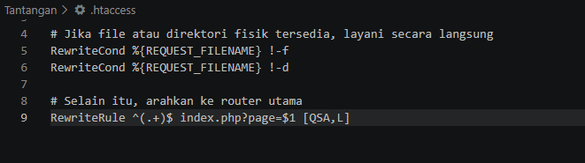

URL ringkas:

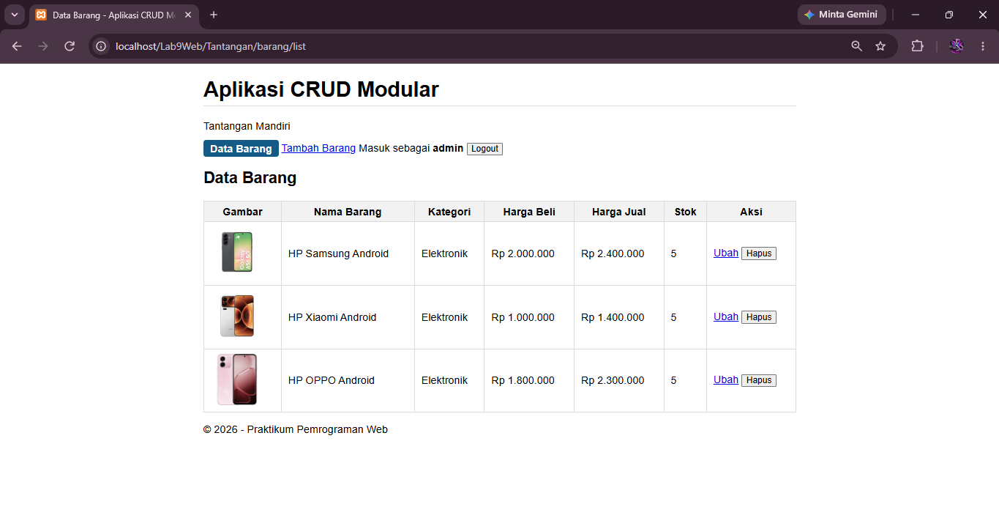

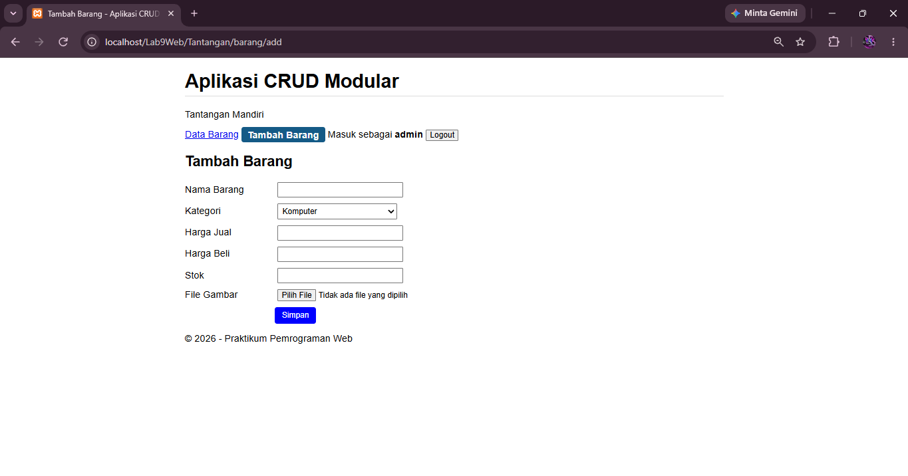


Rute tidak dikenal:


Pengguna belum login dialihkan ke halaman Login (status 302):


URL cara lama tetap berfungsi:


**Keterangan:**

URL `/barang/list`, `/barang/add`, dan `/barang/edit?id=13` dapat dibuka dengan CSS dan menu tampil normal, sehingga tag `<base>` berfungsi. Parameter `id` ikut diteruskan berkat flag `QSA`. Rute asing menghasilkan halaman 404 dari aplikasi, dan URL lama `index.php?page=barang/list` tetap berfungsi. Seluruh pengecekan login tetap berlaku pada URL ringkas.

---

## Daftar Rute

**Latihan 3** (`Latihan3/index.php`)

| Rute (`?page=`) | File | Keterangan |
|---|---|---|
| `home` | `views/home.php` | Halaman utama (default) |
| `tentang` | `views/tentang.php` | Tentang aplikasi |
| `profil` | `views/profil.php` | Identitas mahasiswa |
| `produk` | `views/produk.php` | Daftar produk |
| `kontak` | `views/kontak.php` | Kontak |
| selain di atas | `views/404.php` | Status HTTP 404 |

**Latihan 4** (`Latihan4/index.php`)

| Rute (`?page=`) | File | Keterangan |
|---|---|---|
| `barang/list` | `modules/barang/list.php` | Menampilkan data barang (default) |
| `barang/add` | `modules/barang/add.php` | Form dan proses tambah barang |
| `barang/edit` | `modules/barang/edit.php` | Form dan proses ubah barang (`&id=`) |
| `barang/delete` | `modules/barang/delete.php` | Proses hapus barang (hanya POST) |
| selain di atas | `views/404.php` | Status HTTP 404 |

**Tantangan** (`Tantangan/index.php`, URL ringkas didukung oleh `.htaccess`)

| Rute | URL ringkas | Login | Keterangan |
|---|---|---|---|
| `barang/list` | `/barang/list` | Wajib | Data barang (default) |
| `barang/add` | `/barang/add` | Wajib | Tambah barang |
| `barang/edit` | `/barang/edit?id=...` | Wajib | Ubah barang |
| `barang/delete` | `/barang/delete` | Wajib | Hapus barang (hanya POST) |
| `auth/login` | `/auth/login` | Tidak | Halaman login |
| `auth/logout` | `/auth/logout` | Wajib | Logout (hanya POST) |
| selain di atas | | | Halaman 404 |

---

## Jawaban Pertanyaan Pemahaman

**1. Jelaskan pengertian modularisasi program dan minimal tiga manfaatnya.**

Modularisasi adalah teknik membagi aplikasi menjadi bagian-bagian yang lebih kecil berdasarkan fungsi atau tanggung jawabnya, sehingga setiap bagian dapat dipakai kembali oleh bagian aplikasi lain. Manfaatnya: (1) kode tidak ditulis berulang, misalnya header, footer, koneksi database, dan function validasi cukup dibuat sekali; (2) perubahan tampilan atau logika cukup dilakukan pada modul terkait, tidak pada banyak file; (3) pemeliharaan lebih mudah karena tanggung jawab tiap file jelas; (4) pekerjaan dapat dibagi per modul sehingga mengurangi konflik pada pengembangan tim.

**2. Apa perbedaan `include` dan `require` ketika file yang dipanggil tidak ditemukan?**

`include` hanya menghasilkan peringatan (*warning*) dan eksekusi program berlanjut, sedangkan `require` menghasilkan *fatal error* dan eksekusi program dihentikan. Hal ini terbukti pada praktik: baris "Sesudah pemanggilan" tetap tampil pada `include` tetapi tidak tampil pada `require`.

**3. Mengapa `require_once` sesuai digunakan untuk memuat konfigurasi database?**

Konfigurasi database adalah file wajib, karena aplikasi tidak dapat bekerja tanpa koneksi. `require` memastikan program berhenti jika file hilang sehingga masalah cepat diketahui. Bagian `_once` mencegah file dimuat berulang kali, sehingga koneksi atau function di dalamnya tidak dideklarasikan ganda yang dapat menimbulkan error seperti *Cannot redeclare function*.

**4. Jelaskan perbedaan parameter, argumen, dan nilai return pada function.**

Parameter adalah variabel yang didefinisikan pada deklarasi function, misalnya `$panjang` dan `$lebar` pada `hitungLuasPersegiPanjang($panjang, $lebar)`. Argumen adalah nilai yang dikirim saat function dipanggil, misalnya `8` dan `5` pada `hitungLuasPersegiPanjang(8, 5)`. Nilai return adalah nilai yang dikembalikan function kepada bagian program yang memanggilnya melalui `return`, sehingga dapat disimpan, dihitung kembali, atau dipakai dalam kondisi. Berbeda dengan `echo` yang hanya menampilkan keluaran.

**5. Mengapa header dan footer sebaiknya dipisahkan dari konten halaman?**

Header dan footer dipakai oleh semua halaman, sedangkan konten berbeda pada tiap halaman. Dengan dipisahkan, tampilan konsisten, perubahan pada header atau footer cukup dilakukan di satu file dan langsung berlaku di semua halaman, serta file halaman menjadi lebih ringkas karena hanya berisi kontennya.

**6. Apa fungsi `index.php` pada pola routing yang dipraktikkan?**

`index.php` berfungsi sebagai titik masuk aplikasi sekaligus router. File ini membaca parameter `page`, memeriksanya terhadap daftar rute yang diizinkan, menentukan file konten yang akan dimuat (atau halaman 404), lalu memuat `header.php`, file konten, dan `footer.php` secara berurutan.

**7. Mengapa router sebaiknya menggunakan whitelist rute?**

Whitelist memastikan hanya halaman yang memang didaftarkan oleh aplikasi yang dapat dimuat. Nilai dari URL hanya dipakai sebagai kunci pencarian, bukan sebagai path file, sehingga pengguna tidak dapat memanggil file lain. Rute yang tidak terdaftar langsung menghasilkan halaman 404 dengan status HTTP 404.

**8. Apa risiko jika input `page` langsung digabungkan menjadi path file yang di-`require`?**

Risikonya adalah *path traversal* dan *file inclusion*. Penyerang dapat memasukkan nilai seperti `../config/database` atau path file lain di server sehingga file yang tidak seharusnya diakses ikut dimuat dan dijalankan, misalnya file konfigurasi atau file sensitif lainnya. Karena itu pada praktik dipakai whitelist, dan percobaan `page=../helpers/functions` menghasilkan 404.

**9. Apa fungsi aturan `RewriteCond` dan `RewriteRule` pada `.htaccess`?**

`RewriteCond` menetapkan syarat sebelum aturan dijalankan. Pada praktik, `RewriteCond %{REQUEST_FILENAME} !-f` dan `!-d` berarti aturan hanya berlaku jika permintaan bukan file dan bukan direktori yang benar-benar ada, sehingga CSS, gambar, dan file fisik lain tetap dilayani langsung. `RewriteRule ^(.+)$ index.php?page=$1 [QSA,L]` meneruskan permintaan lain ke router `index.php` dengan alamat yang diminta sebagai nilai `page`. Flag `QSA` mempertahankan *query string* (misalnya `?id=13`) dan `L` menandai aturan terakhir.

**10. Sebutkan bagian aplikasi CRUD yang paling tepat dipindahkan ke `config`, `views`, `helpers`, dan `modules`.**

- **`config/`**: konfigurasi aplikasi, yaitu koneksi database (`database.php`, dahulu `koneksi.php`).
- **`views/`**: komponen tampilan yang dipakai bersama, yaitu `header.php`, `footer.php`, dan `404.php`.
- **`helpers/`**: function umum yang dipakai banyak modul, yaitu `functions.php` berisi `formatRupiah()`, `e()`, `validasiEmail()`, `hitungDiskon()`, dan `ringkasTeks()`.
- **`modules/`**: fitur aplikasi yang dikelompokkan berdasarkan domain, yaitu halaman CRUD barang (`list.php`, `add.php`, `edit.php`, `delete.php`) di `modules/barang/`, serta login dan logout di `modules/auth/`.

---

## Kendala dan Cara Mengatasinya

| No | Kendala | Penyebab | Cara mengatasi |
|---|---|---|---|
| 1 | Muncul *Fatal error: No connection could be made because the target machine actively refused it* saat membuka Latihan 4. | Server MySQL di XAMPP belum dijalankan. | Klik **Start** pada modul MySQL di XAMPP Control Panel, lalu refresh halaman. |
| 2 | Halaman *Not Found* bawaan Apache muncul saat membuka `Latihan3/index.php`. | Nama folder atau lokasi `index.php` tidak sesuai dengan alamat yang dibuka. | Memastikan nama folder sama dengan alamat dan `index.php` berada langsung di dalam folder tersebut. |
| 3 | Pesan sukses/gagal tampil tanpa warna. | Aturan CSS `.pesan` belum terbaca browser. | Memastikan blok CSS ada di `style.css`, menyimpan file, lalu refresh paksa (Ctrl+F5). |
| 4 | Data barang ikut terhapus saat menguji tombol Hapus. | Tombol Hapus diklik pada data asli. | Data dimasukkan kembali lewat form Tambah Barang atau perintah SQL `INSERT` di phpMyAdmin. Pengujian hapus selanjutnya memakai data tambahan. |
| 5 | CSS dan gambar hilang setelah URL diubah menjadi `/barang/list`. | Path relatif dibaca dari folder `barang/`. | Menambahkan tag `<base href="...">` pada `header.php`. |
| 6 | Setelah menyimpan data, alamat berubah menjadi `/barang/index.php?page=...`. | Redirect masih memakai path relatif `index.php`. | Mengganti seluruh redirect menjadi `header('Location: ' . baseUrl() . 'index.php?page=...')`. |
| 7 | Halaman edit menampilkan "Data tidak tersedia". | Parameter `id` diisi teks penanda, bukan angka id barang. | Memakai id barang yang sebenarnya, misalnya `edit?id=13`. |

## Kesimpulan

Berdasarkan Praktikum 9, dapat disimpulkan bahwa modularisasi membuat aplikasi PHP lebih rapi, mudah dipelihara, dan mudah dikembangkan. `include` dan `require` memuat file lain dengan perilaku berbeda saat file tidak ditemukan, sedangkan `require_once` cocok untuk file wajib seperti template, konfigurasi, dan helper. Template header dan footer menghilangkan pengulangan kode, dan function yang dikumpulkan dalam file helper dapat dipakai ulang di banyak halaman.

Penataan struktur direktori (`config`, `views`, `helpers`, `modules`, `assets`) dan router `index.php` dengan *whitelist* membuat aplikasi aman dari pemanggilan file yang tidak dimaksud, karena input URL tidak pernah dipakai langsung sebagai path file. Penerapan pada CRUD Praktikum 8 menunjukkan bahwa seluruh fitur tetap berjalan, dengan koneksi database hanya di satu file dan penghapusan data dilakukan lewat metode POST. Pada tantangan mandiri, menu aktif, pesan sukses/gagal, pembatasan akses login, dan URL rewrite melengkapi aplikasi, sementara perlindungan CSRF dan pengelolaan file gambar saat data dihapus masih dapat dikembangkan lebih lanjut.

## Dokumentasi

Screenshot hasil browser diletakkan setelah penjelasan masing-masing langkah di folder `images/`. Pastikan nama file gambar sama dengan yang tertulis di README ini, semua gambar sudah ada di repository, folder `gambar/` pada `Latihan4` dan `Tantangan` ikut ter-upload, file `setup_user.php` tidak ikut di-*commit*, data pada halaman Kontak berupa data contoh, dan repository berstatus **Public** sebelum link dikumpulkan.
